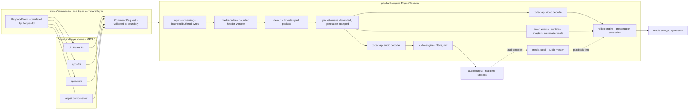

# 01 — Architecture: The Crate & Boundary Plan

> Planning doc 01/15 · Task 1.A1 · Draft for Lead review. The authoritative brief
> is [MASTER-PROMPT.md](MASTER-PROMPT.md) ("MP"). This document implements MP §3
> (boundaries), §4 (monorepo layout), §8 (engine requirements), §9 (Rust-only
> policy) and §16 (phases). Every carried-over decision cites its MP section;
> everything invented here is marked.

**Conventions**

- **MP §n** — decision traced to the MASTER-PROMPT (binding).
- **[PROPOSAL]** — invented here, beyond the brief; needs explicit Lead
  accept/reject.
- **[VERIFY]** — factual claim needing source-linked evidence (docs 02/04 own
  the evidence).
- External crates are **not** evaluated in this document — docs 04 and 11 own
  candidate selection and auditing (MP §9). Only `wgpu` and Tauri are named,
  because MP itself names them (MP §2, §4, §10).

**Contents** — §1 overview · §2 crate registry · §3 core type system · §4
threading model · §5 boundary enforcement in CI · §6 crate governance · §7 ADR
register · §8 open decisions requested from the Lead.

---

## 1. Architecture overview

### 1.1 The nine boundary rules as an enforced contract

MP §3 lists nine boundary rules. Rule 3.8 makes the set enforceable: "an
automated boundary check runs in CI". We therefore restate each rule as a
numbered contract **ARCH-1 … ARCH-9** with a machine check attached. A boundary
without a failing check is not a boundary — it is a hope.

| ID | Contract (traced to MP §3) | Machine check (specified in §5 below) |
|----|----------------------------|----------------------------------------|
| ARCH-1 | `media-types` depends on nothing UI, GPU or platform-specific (§3.1) | external-dep category allowlist for `media-types` is empty in v1; internal deps = none |
| ARCH-2 | `input` and `demux` depend only on media types and shared interfaces (§3.2); extended to `streaming` and `media-probe` **[PROPOSAL]** | per-crate internal-dep allowlist in the boundaries manifest |
| ARCH-3 | the playback engine orchestrates sources, packets, decoders, clocks, queues, sinks and cancellation; it owns no UI state (§3.3) | `playback-engine` denylist: `ui/`, all `apps/`, `theme-tokens`; its only UI-facing surface is typed events |
| ARCH-4 | the renderer is isolated from decoding and demuxing (§3.4) | `renderer-wgpu` may not depend on `codecs`, `codec-api`, `demux`, `input` |
| ARCH-5 | one typed command layer serves desktop UI (Tauri IPC), web UI (wasm binding), CLI, tests and the optional control server (§3.5) | every client depends on `commands`; `ui/` import-lint forbids any other engine import; apps expose only the command layer over IPC |
| ARCH-6 | platform adapters implement explicit traits and do not leak OS types into the core (§3.6) | `platform-*` crates appear in no L0–L4 dependency list; adapter traits are defined in core crates, implemented below |
| ARCH-7 | test utilities may depend on production crates, never the reverse (§3.7) | no production edge into `testkit` (dev-edges too — see §8, question Q1) |
| ARCH-8 | no cyclic crate dependencies, no hidden global mutable state (§3.8) | topological check over `cargo metadata` (normal + dev edges); interior-mutability static scan with allowlist |
| ARCH-9 | commands are validated at the boundary and return typed results correlated to requests (§3.9) | `commands::validate` has a coverage test per variant; every reply/event carries `RequestId`; *Accepted* ≠ *Completed* (MP §2 truthful UI) |

**"Shared interfaces" [PROPOSAL].** MP §3.2 says "media types and shared
interfaces" without enumerating the latter. This document defines the shared
interfaces as the Lead-owned L1 contracts: `media-types`, `plugin-api`,
`codec-api`, `commands` (Lead ownership of exactly these four is also asserted
in §6 below). `control-protocol` is a shared interface for control-server
clients only.

### 1.2 Playback pipeline: end-to-end dataflow

The pipeline below is MP §3's pipeline paragraph, expanded into ordered stages.
Every stage boundary is a typed value crossing a crate boundary.

1. **Command.** A client — desktop UI over Tauri IPC, web UI over the wasm
   binding, CLI, an integration test, or the control server — submits a
   `CommandRequest`. The command layer validates it at the boundary (ARCH-9)
   and correlates the reply by `RequestId`. Mutating commands answer
   *Accepted* immediately; *Completed*/*Failed* arrives later as an event. The
   UI must not show an operation as successful before *Completed* (MP §2).
2. **Open.** `EngineSession` (`playback-engine`) resolves the validated
   `SourceUri` through the plugin registry: an `Access` implementation
   (`input` for local sources, `streaming` for network protocols) yields a
   `SourceStream` with bounded read-ahead, deadlines and cancellation
   (MP §12).
3. **Probe.** `media-probe` scores registered demuxer manifests against a
   bounded header window (probing depth is bounded — MP §12). Outcome is a
   `ProbeReport` (format, tracks, metadata) or a typed `Unsupported` carrying
   whatever format info is known (MP §8: never fabricate, never fail silently).
4. **Demux.** The selected demuxer emits timestamped `Packet`s per track.
   Missing PTS/DTS and discontinuities are explicit variants, never sentinel
   numbers (MP §8; types in §3 below).
5. **Bounded queues.** Packets enter per-track bounded queues. A full queue
   blocks the demux thread — that backpressure is the pacing mechanism (MP §8).
   Every queued item carries the pipeline `GenerationId`.
6. **Decode.** Audio and video decode workers — plain threads; no async for
   CPU-heavy decode (MP §8) — pull packets and push `Frame`s through
   `codec-api` traits. Software codecs are pure Rust (MP §2); OS hardware
   decoders are used only per ADR-001, with truthful reporting when active.
7. **Audio path.** Decoded `AudioFrame`s pass the `audio-engine` filter chain
   and mixer, then reach the `audio-output` backend's real-time callback. That
   callback never blocks, never locks, never allocates (MP §8).
8. **One clock.** `media-clock` defines playback time. Audio is master by
   default (MP §3): the audio output position drives the clock. With no audio
   track the clock free-runs on wall time **[PROPOSAL]**.
9. **Video path.** The presentation scheduler (`video-engine`) compares each
   frame's PTS against the clock snapshot and decides: present now, wait, or
   skip because late. Skips are observable events, not silent drops.
   `renderer-wgpu` presents on the surface strategy chosen by ADR-003 and
   never sees demux or decode types (ARCH-4).
10. **Timed events.** Subtitles, chapters, metadata and track-selection
    changes are timed events on the same clock model (MP §3) — no side
    channels, no second clock.
11. **Cancellation.** Seek, stop, source replacement and track switch bump the
    `GenerationId`; stale packets, frames and in-flight results are dropped at
    the earliest checkpoint and counted (MP §8).

### 1.3 Diagrams

**Pipeline dataflow** (mermaid):



**Layer stack** (ASCII; arrows = "may depend on"):

```
 L6  apps/desktop (Tauri)  apps/web (wasm)  apps/cli  apps/control-server
     plugin-host-wasm      ui/ (React+TS, generated bindings only)
                      |  composition roots: wire registry, sinks, surfaces
 v
 L5  platform-windows   platform-linux   platform-macos
                      |  audited OS-service adapters; unsafe only here (MP §9)
 v
 L4  playback-engine   audio-output   renderer-wgpu
                      |  orchestration + device/surface output
 v
 L3  codecs   audio-engine   video-engine   transcode
                      |  pipeline stages: decode impls, filters, scheduling
 v
 L2  input  streaming  demux  media-probe  packet-queue  media-clock
     subtitles  playlists  device-discovery
                      |  engine primitives (ARCH-2 confinement)
 v
 L1  commands*  plugin-api*  codec-api*  control-protocol
     product-config  settings-schema  localization  theme-tokens
                      |  contracts & configuration  (* = Lead-owned)
 v
 L0  media-types*
                      |  explicit types, error taxonomy, no I/O
 dev testkit  (may depend on any production crate; nothing depends on it)
```

### 1.4 Layer model and invariants

| Layer | Units | Dependency rule |
|-------|-------|-----------------|
| L0 core types | `media-types` | no project-internal deps; no UI/GPU/platform categories (ARCH-1) |
| L1 contracts & config | `commands`, `plugin-api`, `codec-api`, `control-protocol`, `product-config`, `settings-schema`, `localization`, `theme-tokens` | depend only on L0 + whitelisted same-layer pairs |
| L2 engine primitives | `input`, `streaming`, `demux`, `media-probe`, `packet-queue`, `media-clock`, `subtitles`, `playlists`, `device-discovery` | L0–L1 only (ARCH-2) |
| L3 pipeline | `codecs`, `audio-engine`, `video-engine`, `transcode` | L0–L2 |
| L4 orchestration & output | `playback-engine`, `audio-output`, `renderer-wgpu` | engine sees L0–L3; outputs see their trait owners |
| L5 platform adapters | `platform-{windows,linux,macos}` | implement traits defined in L1/L2/L4; never depended on by L0–L4 (ARCH-6) |
| L6 apps & hosts | `apps/*`, `plugin-host-wasm`, `ui/` | composition roots; nothing depends on them |
| dev | `testkit` | may depend on any production crate; nothing depends on it (ARCH-7) |

**Invariants.** (1) Every internal dependency edge points from a higher layer
to a lower layer, or is one of the whitelisted same-layer pairs
(`control-protocol → commands`). (2) Adapter traits live in core crates; L5
crates implement them — so OS types can structurally never appear in a core
signature (ARCH-6). (3) The only types that cross the engine↔UI boundary are
`commands` and `media-types` values (ARCH-5). These three invariants are what
§5's checker proves on every commit.

---

## 2. Crate registry

This is the complete registry of MP §4's `crates/`, `apps/` and `ui/`. The
`plugins/` directory of MP §4 is **not** extra crates: `plugins/builtin/` is
the set of builtin plugin registrations (manifests + Cargo features) inside
the domain crates below, and `plugins/extensions/` holds example WASM
extension packages consumed by `plugin-host-wasm` tests (MP §6).

**How to read a crate section.** Each section has the seven required fields:
(a) *Responsibility*; (b) *Interface sketch* (illustrative Rust, not final);
(c) *Deps* — **internal** dependencies only; external crates are chosen in docs
04/11 and must respect the layer categories; (d) *Never* — prohibitions;
(e) *Tests*; (f) *Phase* introduced (MP §16); (g) *Plugins* — which builtin
plugin kinds of MP §6 live there. ★ = Lead-owned shared interface.

### 2.1 Summary table

| Unit | Kind | Layer | Internal deps | Phase (MP §16) | Plugin kinds (MP §6) |
|------|------|-------|---------------|----------------|----------------------|
| `media-types` ★ | crate | L0 | — | 1 | — |
| `commands` ★ | crate | L1 | media-types | 1 | — |
| `plugin-api` ★ | crate | L1 | media-types | 1 | — (contract) |
| `codec-api` ★ | crate | L1 | media-types | 1 | — (contract) |
| `control-protocol` | crate | L1 | commands | 7 **[P]** | — |
| `product-config` | crate | L1 | — | 1 | — |
| `settings-schema` | crate | L1 | — | 1 | — |
| `localization` | crate | L1 | — | 1 | — |
| `theme-tokens` | crate | L1 | — | 1 | — |
| `input` | crate | L2 | media-types, plugin-api | 2 | access |
| `streaming` | crate | L2 | media-types, plugin-api | 6 | network protocols |
| `demux` | crate | L2 | media-types, plugin-api | 2 | demuxers |
| `media-probe` | crate | L2 | media-types, plugin-api | 2 | metadata providers (partial) |
| `packet-queue` | crate | L2 | media-types | 2 | — |
| `media-clock` | crate | L2 | media-types | 2 | — |
| `subtitles` | crate | L2 | media-types, plugin-api | 5 | subtitle formats |
| `playlists` | crate | L2 | media-types, plugin-api | 4 | playlist formats |
| `device-discovery` | crate | L2 | media-types, plugin-api | 7 | services discovery |
| `codecs` | crate | L3 | codec-api, plugin-api, media-types | 2 (breadth 5, encoders 7) | decoders, encoders |
| `audio-engine` | crate | L3 | media-types, media-clock, plugin-api | 2 | audio filters |
| `video-engine` | crate | L3 | media-types, media-clock, plugin-api | 2 | video filters |
| `transcode` | crate | L3 | media-types, plugin-api, codec-api, media-probe | 7 | muxing **[P]** |
| `playback-engine` | crate | L4 | L0–L3 engine crates + commands | 2 | — (registry host) |
| `audio-output` | crate | L4 | media-types, audio-engine | 2 | audio outputs |
| `renderer-wgpu` | crate | L4 | media-types, video-engine | 2 | video output |
| `platform-windows` | crate | L5 | media-types, codec-api, audio-output, renderer-wgpu, device-discovery | 2 min → 7 | OS impls behind plugin traits |
| `platform-linux` | crate | L5 | same as above | 2 min → 7 | same |
| `platform-macos` | crate | L5 | same as above | 2 min → 7 | same |
| `plugin-host-wasm` | crate | L6 | plugin-api, media-types, commands | 7 | all kinds (sandboxed) |
| `testkit` | dev-crate | dev | any production crate | 1 → all | conformance kit |
| `apps/desktop` | app | L6 | engine + impls + outputs + platforms + contracts + `ui/` | 2 skeleton → 4 | composition root |
| `apps/web` | app | L6 | engine + wasm outputs + commands + `ui/` | 7 **[P]** | — |
| `apps/cli` | app | L6 | engine + commands + contracts | 2 | — |
| `apps/control-server` | app | L6 | control-protocol, commands, engine, contracts | 7 **[P]** | — |
| `ui/` | TS workspace | L6 | generated bindings only | 2 skeleton → 4 | UI panel host side |

[P] = [PROPOSAL] on the phase; see §8.

### 2.2 L0 — core types

#### `crates/media-types` ★ — the shared vocabulary

**(a) Responsibility.** The explicit type system every other crate speaks:
sources, streams, tracks, packets, frames, timestamps, time bases,
generations, durations, rates — plus the stage-tagged error taxonomy (MP §8).
It contains data types and pure functions only. It is deliberately boring,
extremely stable, and the most reviewed crate in the repo.

**(b) Interface sketch.** Full design in §3 of this doc; headline:

```rust
pub struct SourceUri(/* validated, redactable */);
pub struct StreamId(u32);
pub struct TrackId(u32);
pub struct Track { /* id, kind, language, codec, flags, timing */ }
pub struct Packet { /* track, pts/dts: Stamp, data: SharedBytes, flags, generation */ }
pub enum Frame { Audio(AudioFrame), Video(VideoFrame), Subtitle(SubtitleFrame) }
pub struct Timestamp { ticks: i64, base: TimeBase }
pub struct TimeBase { num: u32, den: u32 }
pub struct GenerationId(u64);
pub enum Duration { Known(Nanoseconds), Unknown }
pub struct Rate { num: u32, den: u32 }
pub struct EngineError { stage: PipelineStage, kind: ErrorKind, /* … */ }
```

**(c) Deps.** None internal; std-only in v1 **[PROPOSAL]** (any future
external dep must survive the doc-11 audit and the empty-category check).
**(d) Never.** No I/O, no threading primitives in public API, no UI/GPU/
platform types (ARCH-1), no sentinel numbers (MP §8), no format-specific
parsing — that belongs to `demux`/`codecs`/`subtitles`.
**(e) Tests.** Property tests for time-base conversion covering overflow,
discontinuity and missing timestamps (MP §8); redaction tests; serialization
round-trips. **(f) Phase 1.** **(g) Plugins.** None.

### 2.3 L1 — contracts & configuration

#### `crates/commands` ★ — the one typed command layer

**(a) Responsibility.** Defines every command, acknowledgement and playback
event the outside world can exchange with the engine, plus boundary
validation (MP §3.5, §3.9). Serves Tauri IPC, the wasm binding, the CLI,
tests and the control server — one vocabulary, five transports (ARCH-5). It
is transport-agnostic: bytes/wire encoding for the control server lives in
`control-protocol`.

**(b) Interface sketch.**

```rust
pub struct RequestId(u64);
pub enum Command {
    Open { uri: SourceUri, flags: OpenFlags }, Play, Pause, TogglePause,
    Seek { to: SeekTarget }, Stop,
    SelectTrack { track: TrackId, selected: bool },
    SetRate { rate: Rate }, SetVolume { volume: Volume },
    LoadSubtitle { uri: SourceUri }, /* enum grows under Lead change control */
}
pub struct CommandRequest { pub id: RequestId, pub command: Command }
pub enum CommandAck { Accepted, Completed(Completion), Failed(EngineError) }
pub enum PlaybackEvent { /* state, time, track list, buffering, eos, error … */ }
pub fn validate(req: &CommandRequest) -> Result<(), CommandError>;
```

**(c) Deps.** `media-types` only. Command *availability* filtering per
feature exposure (MP §5) happens in apps using `product-config`
**[PROPOSAL]**, keeping this crate engine-pure.
**(d) Never.** No engine logic, no I/O, no secrets in results (MP §12), no
UI concepts beyond data (no styling, no layout).
**(e) Tests.** Validation-coverage test per `Command` variant; correlation
property (every ack/event references a live `RequestId`); generated TS
binding compiles (doc 05 details the layer).
**(f) Phase 1.** **(g) Plugins.** None.

#### `crates/plugin-api` ★ — manifests, registry, cross-cutting plugin traits

**(a) Responsibility.** The plugin contract of MP §6: manifests (id, kind,
version, capabilities, priority, permissions, config_schema, API version,
dependencies), the registry built from them, selection by capability and
priority, API versioning — plus the **cross-cutting media plugin traits**
that more than one L2 crate must name: `SourceStream`, `Access`, `Demuxer`
(with probe scoring), `SubtitleParser`, `MetadataProvider`
**[PROPOSAL: trait placement — see §8 Q3]**. Pipeline-stage traits stay in
their domain crates (`codec-api`, `audio-engine`, `video-engine`).

**(b) Interface sketch.**

```rust
pub struct PluginManifest { /* id, kind, version, capabilities, priority,
                               permissions, config_schema, api_version, dependencies */ }
pub enum PluginKind { Access, Demuxer, Decoder, Encoder, AudioFilter, VideoFilter,
                       AudioOutput, VideoOutput, SubtitleFormat, PlaylistFormat,
                       NetworkProtocol, MetadataProvider, ServiceDiscovery, UiPanel }
pub trait SourceStream: Send { /* bounded read/seek/size, deadline-aware */ }
pub trait Access { fn schemes(&self) -> &[&str];
                   fn open(&self, uri: &SourceUri) -> Result<Box<dyn SourceStream>, EngineError>; }
pub trait Demuxer { fn score(&self, header: &[u8]) -> ProbeScore;
                    fn start(&mut self, src: Box<dyn SourceStream>) -> Result<DemuxInfo, EngineError>;
                    fn next_packet(&mut self, out: &mut Packet) -> Result<(), EngineError>;
                    fn seek(&mut self, target: Timestamp) -> Result<SeekPoint, EngineError>; }
pub struct PluginRegistry { /* built from manifests; select by capability + priority */ }
```

**(c) Deps.** `media-types`. **(d) Never.** No implementations, no dynamic
loading of native code — forbidden outright by MP §6 — no engine state, no
UI. Factories return type-erased instances that consumers downcast to the
domain trait; a downcast mismatch is a manifest lie and fails the plugin
conformance kit **[PROPOSAL]**.
**(e) Tests.** Manifest validation; registry selection (capability +
priority, config enable/disable/reorder but never invent — MP §6); API
version compatibility; conformance-kit contract itself.
**(f) Phase 1.** **(g) Plugins.** None (it is the contract).

#### `crates/codec-api` ★ — decoder/encoder contract

**(a) Responsibility.** The codec-facing contract of MP §6/§8: `Decoder`,
`Encoder`, the frame sink decoders push to, and a backend-neutral hardware
decoder abstraction (per ADR-001). Pure contract + configuration types; no
implementations.

**(b) Interface sketch.**

```rust
pub trait Decoder: Send {
    fn configure(&mut self, cfg: &DecoderConfig) -> Result<(), EngineError>;
    fn decode(&mut self, packet: Packet, out: &mut dyn FrameSink) -> Result<DecodeOutcome, EngineError>;
    fn flush(&mut self, out: &mut dyn FrameSink) -> Result<DecodeOutcome, EngineError>;
}
pub enum DecodeOutcome { Emitted { frames: u32 }, NeedMoreInput, Drained,
                         Recovered { skipped: u32, reason: RecoverReason } }
pub trait FrameSink { fn accept(&mut self, frame: Frame) -> Result<(), EngineError>; }
pub trait HwAccelerator { /* opaque hardware contract — bounded by ADR-001 */ }
```

**(c) Deps.** `media-types`. **(d) Never.** No codec implementations, no
platform types (hardware stays abstract), no policy (selection policy is the
registry's, MP §6).
**(e) Tests.** Contract test-suite reused by every codec in `codecs` and by
the conformance kit (MP §6); corruption-injection contract tests (bounded
recovery, MP §8).
**(f) Phase 1 (contract), exercised from Phase 2.** **(g) Plugins.** None.

#### `crates/control-protocol` — versioned loopback wire protocol

**(a) Responsibility.** Encodes/decodes commands, acks and events for the
optional local control server (MP §3.5): loopback-only, versioned, every
request validated, authentication for sensitive operations (MP §12).
**(b) Interface sketch.**

```rust
pub enum WireFrame { Request { id: RequestId, command: Command },
                     Reply { id: RequestId, ack: CommandAck },
                     Event { event: PlaybackEvent } }
pub fn encode(f: &WireFrame, v: ProtocolVersion) -> Result<Vec<u8>, ProtocolError>;
pub fn decode(bytes: &[u8], v: ProtocolVersion) -> Result<WireFrame, ProtocolError>;
```

**(c) Deps.** `commands` (same-layer whitelist). **(d) Never.** Engine
logic, non-loopback binding, unauthenticated sensitive ops, silent
incompatibility (version mismatch is a typed error).
**(e) Tests.** Wire fuzzing (untrusted input — MP §12), version
negotiation, round-trip properties.
**(f) Phase 7 [PROPOSAL — could be defined alongside `commands` in Phase 1;
see §8 Q5].** **(g) Plugins.** None.

#### `crates/product-config` — the config-driven product model

**(a) Responsibility.** Typed, validated model of `product.toml` (against
`product.schema.json`) and the layered resolution: product defaults <
profile < admin override < user preferences < command-line flags < session
(MP §5). Owns identity (names, identifiers), window defaults, feature
exposure, default playback/track-selection rules, cache and resource limits,
telemetry defaults (opt-in only), URLs, schema version and migrations.
**(b) Interface sketch.**

```rust
pub enum Layer { Product, Profile, Admin, User, Flags, Session }
pub fn load(layers: &[(Layer, PathBuf)]) -> Result<Product, ConfigDiagnostic>;
impl Product { pub fn identity(&self) -> &Identity; pub fn feature_exposure(&self) -> &FeatureExposure;
               pub fn resource_limits(&self) -> &ResourceLimits; /* … */ }
```

**(c) Deps.** None internal **[PROPOSAL]** — cross-checks against
`settings-schema` happen in `tools/config-validator` (MP §4), not as a crate
edge. **(d) Never.** Playback logic; silently replacing invalid critical
config (must fail with an actionable diagnostic — MP §5); hardcoding
user-visible strings (MP §5).
**(e) Tests.** Schema violations fail loudly; precedence tests for all six
layers; rebrand propagation acceptance test (MP §5: name/logo/accent/defaults
propagate to window title, installer, About, CLI identity, logs, docs).
**(f) Phase 1.** **(g) Plugins.** None.

#### `crates/settings-schema` — one settings schema, many generators

**(a) Responsibility.** The single source of truth for every setting (type,
range, description key, restart-required, UI placement — MP §5). Generates
the settings screens' schema, `--help` and CLI flags, documentation and the
validator. No option is defined twice.
**(b) Interface sketch.**

```rust
pub struct SettingDef { pub key: SettingKey, pub ty: SettingType, pub range: Option<ValueRange>,
                        pub description: MessageKey, pub restart_required: bool,
                        pub placement: UiPlacement, pub default: DefaultValue }
pub enum GenTarget { TsTypes, CliHelp, Docs, Validator }
pub fn generate(schema: &SettingsSchema, target: GenTarget, out: &mut impl Write) -> Result<(), GenError>;
```

**(c) Deps.** None internal. **(d) Never.** UI construction, option
duplication, defaults that contradict `product.toml` (validator's job to
catch). **(e) Tests.** Uniqueness of keys; generated TS typechecks; generated
CLI help golden files; generated validator rejects out-of-range values.
**(f) Phase 1.** **(g) Plugins.** None (but plugin manifests reference
`config_schema` — MP §6).

#### `crates/localization` — keys, catalogs, fallback

**(a) Responsibility.** Stable message keys with parameterized messages,
explicit fallback, and catalog auditing (missing/duplicate keys, placeholder
validation — MP §5). Provides the *mechanism*; catalogs are data in
`locales/`.
**(b) Interface sketch.**

```rust
pub struct Locale(/* validated tag */);
pub fn translate(locale: &Locale, key: MessageKey, args: &[Arg]) -> LocalizedString;
pub fn audit_catalogs(dir: &Path) -> Vec<CatalogIssue>; // missing/duplicate/placeholder
```

**(c) Deps.** None internal. **(d) Never.** Literal UI copy in Rust or TSX
(MP §5 — CI fails on it); translating technical identifiers.
**(e) Tests.** Catalog audit as a CI gate (MP §5); fallback correctness;
placeholder mismatch detection.
**(f) Phase 1.** **(g) Plugins.** None.

#### `crates/theme-tokens` — design tokens pipeline

**(a) Responsibility.** Parses the Figma-variables-derived tokens file
(colors, type scale, spacing, radii, shadows — MP §7) and emits CSS
variables for `ui/` and Rust constants for engine-side needs. Components
consume semantic tokens only.
**(b) Interface sketch.**

```rust
pub struct TokenSet { /* semantic + primitive tokens */ }
pub fn parse(source: &str) -> Result<TokenSet, TokenError>;
pub fn emit_css(tokens: &TokenSet, out: &mut impl Write) -> Result<(), TokenError>;
pub fn emit_rust(tokens: &TokenSet, out: &mut impl Write) -> Result<(), TokenError>;
```

**(c) Deps.** None internal. **(d) Never.** Component code, hardcoded
colors outside tokens, layout decisions (layout config's domain — MP §5).
**(e) Tests.** Parse/emit golden tests; the Figma screenshot-diff acceptance
test (MP §7) consumes the emitted CSS (doc 08 owns the pipeline).
**(f) Phase 1 (pipeline), Phase 2 (token proof — MP §16).** **(g) Plugins.** None.

### 2.4 L2 — engine primitives (ARCH-2 confinement zone)

#### `crates/input` — local source access

**(a) Responsibility.** Implements `plugin_api::Access` for local byte
sources: single files first; disc images and capture later, each gated by an
ADR (MP §14, §16). Produces `SourceStream`s with safe path handling (MP §12)
— no symlink escapes, no unbounded read-ahead.
**(b) Interface sketch.**

```rust
pub struct FileAccess { /* … */ }            // implements plugin_api::Access
pub fn register(registry: &mut PluginRegistry); // behind Cargo features (MP §6)
```

**(c) Deps.** `media-types`, `plugin-api` — exactly the ARCH-2 set.
**(d) Never.** Network protocols (`streaming` owns them), demuxing,
parsing container bytes, UI/platform types.
**(e) Tests.** Access conformance (seek/size/deadlines/cancellation);
path-safety tests; fuzzed source patterns via `testkit`.
**(f) Phase 2.** **(g) Plugins.** Access (file; disc per ADR-008).

#### `crates/streaming` — network protocols and their pathologies

**(a) Responsibility.** Implements `Access`/network-protocol plugins for
HTTP(S), HLS, DASH and RTSP where possible (named by MP §16 Phase 6), plus
the network-specific behaviors: bounded buffering, reconnect with bounded
attempts, authentication, redirect and credential policies, TLS verification
(MP §12, §16).
**(b) Interface sketch.**

```rust
pub struct NetworkAccess { /* per protocol, behind Cargo features */ }
pub struct BufferPolicy { /* bounded, observable rebuffering */ }
pub fn register(registry: &mut PluginRegistry);
```

**(c) Deps.** `media-types`, `plugin-api` (ARCH-2 set — buffering wrappers
consume only `SourceStream`). **(d) Never.** Demuxing, unbounded memory,
silent credential leakage (redaction is `media-types` policy), blocking
without deadlines.
**(e) Tests.** Interrupted-network integration (MP §13), reconnect
exhaustion, TLS-failure cases, protocol parser fuzz targets (MP §16),
auth/redirect policy tests. Web limitations recorded in the feature matrix
(raw UDP/RTSP impossible — MP §10).
**(f) Phase 6.** **(g) Plugins.** Network protocols / access.

#### `crates/demux` — container demuxers

**(a) Responsibility.** One module per container format (the format set is
decided by docs 02/04 and the feature matrix), each implementing
`plugin_api::Demuxer`: bounded header parsing, timestamped packet emission
with explicit missing/discontinuous stamps, seek tables, corrupt-input
behavior per MP §8's per-format records.
**(b) Interface sketch.**

```rust
pub mod container_n;      /* one per format — inventory from docs 02/04 */
pub fn register(registry: &mut PluginRegistry);
```

**(c) Deps.** `media-types`, `plugin-api`. **(d) Never.** Decoding, direct
I/O (only via `SourceStream`), unbounded probing, fabricated durations or
metadata (MP §8).
**(e) Tests.** Per-format corpus with recorded expectations (MP §13);
malformed/truncated/discontinuous-timestamp fixtures; differential tests
against VLC 3.0.23 as an external oracle (MP §13); a registered fuzz target
per parser (MP §6, §12).
**(f) Phase 2 (first container), breadth Phase 5.** **(g) Plugins.** Demuxers.

#### `crates/media-probe` — bounded format identification

**(a) Responsibility.** Scores registered demuxer/decoder capabilities
against a bounded header window and produces the `ProbeReport` used to
select a demuxer (MP §6 registry selection; MP §12 probing depth). Also
extracts immediately-available metadata. Unknown ⇒ typed `Unsupported` with
known format info (MP §8).
**(b) Interface sketch.**

```rust
pub struct ProbeReport { pub format: FormatId, pub score: ProbeScore,
                         pub tracks: Vec<Track>, pub metadata: Metadata }
pub struct ProbeLimits { pub max_bytes: u64, pub deadline: Duration }
pub fn probe(src: &mut dyn SourceStream, limits: &ProbeLimits,
             registry: &PluginRegistry) -> Result<ProbeReport, EngineError>;
```

**(c) Deps.** `media-types`, `plugin-api`. **(d) Never.** Full demuxing,
unbounded reads, guessing success (scores below threshold are failures).
**(e) Tests.** Corpus scoring expectations; adversarial headers (MP §12);
latency budget tests (probe latency is a tracked metric — MP §11).
**(f) Phase 2.** **(g) Plugins.** Metadata providers (format sniffing +
tag extraction; heavyweight providers may be WASM extensions — MP §6).

#### `crates/packet-queue` — bounded, generation-aware queues

**(a) Responsibility.** The queue primitive of MP §8: bounded packet/frame
queues with backpressure, generation stamping and stale-drop semantics. One
generic, heavily tested primitive reused for every stage boundary.
**(b) Interface sketch.**

```rust
pub struct BoundedQueue<T> { /* SPSC, capacity-bounded */ }
impl<T: Generational> BoundedQueue<T> {
    pub fn push(&mut self, item: T) -> PushResult;   // Pushed | Full | Closed(gen)
    pub fn pop(&mut self, wait: PopWait) -> PopResult<T>; // Item | Empty | Stale(gen) | Closed(gen)
}
```

**(c) Deps.** `media-types` (for `GenerationId`). **(d) Never.** Media
semantics (no decode/drop policy decisions), unbounded growth, spin-waiting
without deadlines.
**(e) Tests.** Saturation/backpressure tests; stale-generation drops under
concurrent producers; stress tests feeding the soak suite (MP §13).
**(f) Phase 2 (MP §16 first vertical), hardened Phase 3.** **(g) Plugins.** None.

#### `crates/media-clock` — the one playback clock

**(a) Responsibility.** Playback time: clock snapshots (position, rate,
state, generation), rate changes, discontinuity handling, and the
`ClockSource` abstraction whose default implementation is the audio-master
source (MP §3). Free-run mode for audio-less media **[PROPOSAL]**.
**(b) Interface sketch.**

```rust
pub struct ClockSnapshot { pub generation: GenerationId, pub position: Timestamp,
                           pub rate: Rate, pub state: ClockState }
pub trait ClockSource: Send + Sync { fn snapshot(&self) -> ClockSnapshot; }
pub struct PlaybackClock { /* audio master by default; provider pluggable */ }
```

**(c) Deps.** `media-types`. **(d) Never.** I/O, device APIs, UI. The clock
*observes* the audio device; it never drives it directly.
**(e) Tests.** Property tests: rate scaling, overflow-safe arithmetic,
discontinuity resets, generation invalidation after seek (MP §8, §16
Phase 3).
**(f) Phase 2, hardened Phase 3 (MP §16).** **(g) Plugins.** None.

#### `crates/subtitles` — subtitle format parsers

**(a) Responsibility.** Parsers for subtitle formats (inventory from docs
02/04), each implementing `plugin_api::SubtitleParser` and producing timed
`SubtitleFrame`s — text with styling, and image-based cues where formats
require them. Subtitles ride the timed-event model (MP §3).
**(b) Interface sketch.**

```rust
pub struct SubtitleCue { pub span: TimeSpan, pub content: SubtitleContent }
pub fn register(registry: &mut PluginRegistry);
```

**(c) Deps.** `media-types`, `plugin-api`. **(d) Never.** Rendering (that is
presentation), decoding of embedded video subtitles (that is `codec-api`),
unbounded parsing.
**(e) Tests.** Per-format corpus; encoding/RTL/placeholder edge cases
**[VERIFY: edge-case inventory from doc 02]**; fuzz target per parser
(MP §12).
**(f) Phase 5 (MP §16).** **(g) Plugins.** Subtitle formats.

#### `crates/playlists` — playlist models and formats

**(a) Responsibility.** Playlist data model (entries, ordering, metadata)
and parsers/writers for playlist formats (inventory from docs 02/04).
Feeding the engine is not its job: apps submit `Open` commands per entry.
**(b) Interface sketch.**

```rust
pub trait PlaylistParser { fn parse(&self, src: &mut dyn SourceStream)
                              -> Result<Playlist, EngineError>; }
pub struct Playlist { pub entries: Vec<PlaylistEntry>, pub metadata: Metadata }
```

**(c) Deps.** `media-types`, `plugin-api`. **(d) Never.** Playback control,
UI, network fetching (callers provide sources).
**(e) Tests.** Format corpus; malformed playlists; directory expansion
**[PROPOSAL]**; fuzz targets (MP §12).
**(f) Phase 4 (MP §16).** **(g) Plugins.** Playlist formats.

#### `crates/device-discovery` — services discovery

**(a) Responsibility.** The services-discovery plugin kind (MP §6):
enumerating network services and local devices into `Device` lists (URI +
label + kind) for the UI to browse. Protocol inventory is doc 02/04's
output.
**(b) Interface sketch.**

```rust
pub trait ServiceDiscovery { fn discover(&self, ctx: &DiscoveryContext)
                                -> Result<Vec<Device>, EngineError>; }
pub struct Device { pub uri: SourceUri, pub label: String, pub kind: DeviceKind }
```

**(c) Deps.** `media-types`, `plugin-api`. **(d) Never.** Playback side
effects, unbounded scan threads (bounded pools only), UI.
**(e) Tests.** Mocked discovery networks; hardware evidence labeled
separately (MP §13, §14: DVB/capture can't be verified without hardware).
**(f) Phase 7 (MP §16).** **(g) Plugins.** Services discovery.

### 2.5 L3 — pipeline stages

#### `crates/codecs` — builtin decoder/encoder implementations

**(a) Responsibility.** Pure-Rust software codecs implementing
`codec-api` traits, one module per codec behind Cargo features (MP §6
"all core codecs and demuxers start here"). Decoders from Phase 2;
encoders arrive with `transcode` in Phase 7 (MP §16). Per-format records
per MP §8 live with each module.
**(b) Interface sketch.**

```rust
pub mod codec_n;   /* one per codec — inventory from docs 02/04 */
pub fn register(registry: &mut PluginRegistry, features: &FeatureSet);
```

**(c) Deps.** `codec-api`, `plugin-api`, `media-types`.
**(d) Never.** UI/platform/network; fabricating frames or silence on error
(MP §8); unsafe code (MP §9); hiding recoverable corruption (recovery is
bounded and observable — MP §8).
**(e) Tests.** `codec-api` contract suite; decode corpora with hashes;
corruption injection; differential vs VLC oracle (MP §13); fuzz targets
(MP §12); performance benchmarks vs VLC 3.0.23 reported honestly (MP §11).
**(f) Phase 2 (first codec), Phase 5 breadth, Phase 7 encoders.**
**(g) Plugins.** Decoders, encoders.

#### `crates/audio-engine` — filters, mixing, the audio master

**(a) Responsibility.** The audio pipeline after decode: `AudioFilter`
chain (equalizer, compressor, spatializer, stereo widener — the Figma set),
the mixer (track combining, volume, sample-rate conversion), and the
`AudioSink` trait that output backends implement. The audio device position
reported through the sink is the default master clock source (MP §3).
**(b) Interface sketch.**

```rust
pub struct AudioBuffer { pub format: AudioFormat, pub data: SharedBytes, pub pts: Stamp }
pub trait AudioFilter: Send { fn process(&mut self, buf: &mut AudioBuffer) -> Result<(), EngineError>; }
pub struct Mixer { /* filter chain + gain + format negotiation */ }
pub trait AudioSink: Send { fn write(&mut self, buf: &AudioBuffer) -> Result<(), EngineError>;
                            fn latency(&self) -> Option<Duration>; }
```

**(c) Deps.** `media-types`, `media-clock`, `plugin-api`.
**(d) Never.** Device APIs (backends' job), blocking work in the real-time
path, locks across the callback boundary (MP §8), UI.
**(e) Tests.** Filter unit tests with golden buffers; mixer format
negotiation; underrun injection; latency budget tests (MP §11 audio
underruns metric).
**(f) Phase 2, hardened Phase 3.** **(g) Plugins.** Audio filters.

#### `crates/video-engine` — video filters and presentation scheduling

**(a) Responsibility.** The video pipeline after decode: `VideoFilter` chain
(color adjust, crop, deinterlace — inventory per feature matrix),
and the presentation scheduler that turns (frame PTS, clock snapshot) into
a `PresentAction` — present, wait, or skip-late. Defines the `Presenter`
trait that renderers implement.
**(b) Interface sketch.**

```rust
pub trait VideoFilter: Send { fn process(&mut self, frame: VideoFrame)
                                 -> Result<VideoFrame, EngineError>; }
pub enum PresentAction { Present(VideoFrame), WaitUntil(Timestamp), SkipLate { pts: Timestamp } }
pub struct PresentationScheduler { /* frame pipeline vs clock */ }
pub trait Presenter: Send { fn present(&mut self, frame: &VideoFrame) -> Result<PresentInfo, EngineError>; }
```

**(c) Deps.** `media-types`, `media-clock`, `plugin-api`.
**(d) Never.** GPU/rendering APIs, demux/decode types, UI.
**(e) Tests.** Scheduler unit tests against synthetic clocks (present/wait/
skip decisions, late-frame accounting); filter golden tests; dropped-frame
observability (MP §11 metric).
**(f) Phase 2, hardened Phase 3 (A/V sync — MP §16).** **(g) Plugins.** Video filters.

#### `crates/transcode` — recording, conversion, stream output

**(a) Responsibility.** The Phase 7 surface of MP §16 (recording,
conversion, stream output): a pipeline that reuses probe/demux/decode/
encode without the playback clock, driven by `TranscodeProfile`s. Muxing/
encapsulation lives here **[PROPOSAL — MP §6 lists no muxer plugin kind;
see §8 Q2]**.
**(b) Interface sketch.**

```rust
pub struct TranscodeProfile { /* container, tracks, codecs, rates — validated */ }
pub struct TranscodeJob { pub input: SourceUri, pub profile: TranscodeProfile }
pub fn run(job: &TranscodeJob, registry: &PluginRegistry,
           progress: &dyn Fn(Progress)) -> Result<OutputArtifact, EngineError>;
```

**(c) Deps.** `media-types`, `plugin-api`, `codec-api`, `media-probe`.
**(d) Never.** UI, the playback clock, unbounded temp files (resource
limits from `product.toml` — MP §5).
**(e) Tests.** Profile validation; end-to-end golden outputs (hashing
**[VERIFY: encoder determinism across platforms before promising hashes]**);
cancel/resume; resource-limit enforcement.
**(f) Phase 7.** **(g) Plugins.** Muxing **[PROPOSAL]**; consumes encoder plugins.

### 2.6 L4 — orchestration & output

#### `crates/playback-engine` — the session and its pipeline

**(a) Responsibility.** MP §3.3: orchestrates sources, packets, decoders,
clocks, queues, sinks and cancellation. Owns `EngineSession` — the state
machine behind the command layer — thread spawning/shutdown, generation
bumping, recovery policy, event emission. Hosts the plugin registry at
runtime. Owns no UI state.
**(b) Interface sketch.**

```rust
pub struct EngineConfig { /* queue bounds, recovery, cache limits — from product.toml */ }
pub struct SinkSet { pub audio: Box<dyn AudioSink>, pub presenter: Box<dyn Presenter> }
pub struct EngineSession { /* the pipeline; no UI state */ }
impl EngineSession {
    pub fn new(cfg: EngineConfig, registry: PluginRegistry, sinks: SinkSet) -> Result<Self, EngineError>;
    pub fn submit(&mut self, req: CommandRequest) -> CommandAck;  // command layer impl (ARCH-5)
    pub fn events(&mut self) -> &mut EventStream;                  // typed events
    pub fn shutdown(self, timeout: Duration) -> Result<(), EngineError>;
}
```

**(c) Deps.** `media-types`, `commands`, `plugin-api`, `codec-api`,
`media-probe`, `packet-queue`, `media-clock`, `audio-engine`,
`video-engine`. It does **not** depend on implementation crates (`codecs`,
`input`, `demux`, …) — it names traits only; apps link implementations
**[PROPOSAL]**. **(d) Never.** UI state, OS calls, unbounded queues, direct
decoder calls bypassing generations.
**(e) Tests.** The MP §13 integration list: open/play/pause/seek/stop,
repeated seeks, A/V sync, track switching, corrupt and missing files,
interrupted network, device loss, long and short media, reopen cycles, exit
during playback; soak/stress in Phase 8; cancellation race tests.
**(f) Phase 2, reliability Phase 3 (MP §16).** **(g) Plugins.** None (hosts
the registry).

#### `crates/audio-output` — audio output backends

**(a) Responsibility.** The audio-output plugin kind (MP §6): the
`AudioBackend` trait (extends `audio-engine::AudioSink` with device
enumeration/open), backend selection, a null backend for tests/headless,
and the browser (WebAudio-compatible) backend for the wasm target (MP §10).
OS-specific backends are implemented in `platform-*`.
**(b) Interface sketch.**

```rust
pub trait AudioBackend: AudioSink { fn enumerate(&self) -> Vec<DeviceInfo>;
                                    fn open(&mut self, dev: DeviceId, fmt: &AudioFormat)
                                      -> Result<(), EngineError>; }
pub struct NullBackend;      // tests, headless CLI [PROPOSAL]
pub struct WebAudioBackend;  // cfg(target_arch = "wasm32") — MP §10
```

**(c) Deps.** `media-types`, `audio-engine`. **(d) Never.** Decode/mix
logic, blocking or locking inside the real-time callback, OS types in
public signatures (ARCH-6).
**(e) Tests.** Per-backend device tests with real-hardware evidence labeled
separately from mock evidence (MP §13); underrun counting; device-loss
handling (MP §13).
**(f) Phase 2.** **(g) Plugins.** Audio outputs.

#### `crates/renderer-wgpu` — video presentation

**(a) Responsibility.** The video-output plugin kind (MP §6) and the only
GPU citizen: implements `video_engine::Presenter` on wgpu (named by MP §4),
does GPU color conversion (MP §11), owns the `RenderSurface` abstraction
that platform adapters and the web build provide. Isolated from decoding
and demuxing (ARCH-4).
**(b) Interface sketch.**

```rust
pub trait RenderSurface: Send { /* opaque target — strategy per ADR-003 */ }
pub struct Renderer { /* device, pipelines, GPU color conversion */ }
impl Presenter for Renderer { /* … */ }
```

**(c) Deps.** `media-types`, `video-engine` (for `Presenter`, `VideoFrame`).
**(d) Never.** Depend on `demux`/`input`/`codecs`/`codec-api` (ARCH-4); UI
layout; media decisions.
**(e) Tests.** Golden-frame rendering where feasible; WebGPU/WebGL fallback
matrix across Chrome/Firefox/Safari (MP §10); per-OS surface tests feeding
ADR-003 evidence; DPI/scaling cases (MP §7).
**(f) Phase 2 (video-in-webview prototype — MP §16), hardened Phase 4/7.**
**(g) Plugins.** Video output.

### 2.7 L5 — platform adapters

All three share one template: they exist so that MP §9's audited
OS-service exceptions (windowing, audio devices, GPU, hardware decoders)
have exactly one home. They contain the only permitted `unsafe` (with
documented invariants and an ADR reference per module — MP §9), implement
traits defined in core crates, and never leak OS types upward (ARCH-6).

#### `crates/platform-windows`

**(a) Responsibility.** Windows adapters: audio backend, hardware decode
via Media Foundation (named by MP §2; gated on ADR-001), render surface
support for the WebView2-based shell (named by MP §7).
**(b) Interface sketch.**

```rust
pub struct WindowsAudioBackend;  // impl audio_output::AudioBackend — API per ADR-005
pub struct MediaFoundationHw;    // impl codec_api::HwAccelerator — ADR-001
pub struct WindowsSurface;       // impl renderer_wgpu::RenderSurface — ADR-003/004
```

**(c) Deps.** `media-types`, `codec-api`, `audio-output`, `renderer-wgpu`,
`device-discovery`. **(d) Never.** Engine logic, business rules, OS types in
public signatures. **(e) Tests.** Real-device tests labeled as hardware
evidence (MP §13); hw-decode truthfulness tests (reports when active — MP §2).
**(f) Phase 2 (audio + surface minimum) → Phase 7 (hardware decode).**
**(g) Plugins.** Hosts OS implementations behind audio-output/hw-decode traits.

#### `crates/platform-linux`

Identical template: audio backend (API per ADR-005 — PipeWire et al. are
doc-04 candidates), hardware decode via VA-API (named by MP §2, ADR-001),
surface support for WebKitGTK-based shells (named by MP §7 — highest-risk
webview per MP §7; test separately). Same deps/tests/phase as
`platform-windows`.

#### `crates/platform-macos`

Identical template: audio backend (API per ADR-005), hardware decode via
VideoToolbox (named by MP §2, ADR-001), surface support for WKWebView-based
shells (named by MP §7). Same deps/tests/phase as `platform-windows`.

### 2.8 L6 — extension host, dev kit, apps, UI

#### `crates/plugin-host-wasm` — sandboxed extension host

**(a) Responsibility.** MP §6's WASM extension model: install/remove flows,
provenance and trust checks, capability-based permissions, resource limits
(memory, CPU time, I/O), API versioning, and error isolation so a plugin
crash cannot take down playback. Runtime selection is ADR-002; runtime
candidates are evaluated in doc 04.
**(b) Interface sketch.**

```rust
pub struct ResourceLimits { pub memory_bytes: u64, pub cpu: CpuBudget, pub io: IoBudget }
pub struct ExtensionHost { /* registry of installed extensions */ }
impl ExtensionHost {
    pub fn install(&mut self, pkg: &Path, trust: &TrustCheck) -> Result<PluginId, EngineError>;
    pub fn spawn(&self, id: &PluginId, limits: ResourceLimits) -> Result<Instance, EngineError>;
}
```

**(c) Deps.** `plugin-api`, `media-types`, `commands` (UI-panel extensions
interact via the command layer **[PROPOSAL]**). **(d) Never.** Native
dynamic loading (forbidden — MP §6), auto-executing downloaded plugins
(forbidden — MP §6), unlimited resources, silent failure swallowing.
**(e) Tests.** Sandbox escape attempts; resource-limit enforcement; crash
isolation; provenance rejection; the plugin conformance kit (MP §6).
**(f) Phase 7 (MP §16).** **(g) Plugins.** Hosts all kinds, sandboxed —
suited to UI panels, playlist/metadata handlers, light filters (MP §6).

#### `crates/testkit` — fixtures, mocks, conformance (dev-only)

**(a) Responsibility.** The shared test arsenal: corpus fixture access
(MP §13), malformed/truncated/discontinuous generators, mock sources and
sinks, the null presenter, differential-oracle harness (MP §13) and the
plugin conformance kit every plugin must pass (MP §6).
**(b) Interface sketch.**

```rust
pub fn fixture(name: &str) -> Fixture;
pub fn malformed(pattern: Corruption) -> Box<dyn SourceStream>;
pub struct ConformanceRunner;  // runs every plugin kind (MP §6)
pub struct NullPresenter;      // impl video_engine::Presenter
```

**(c) Deps.** Any production crate (ARCH-7 direction). **(d) Never.** Being
a dependency of production code; presenting mock evidence as hardware
evidence (MP §13 labeling).
**(e) Tests.** Self-tests; it *is* the test infrastructure.
**(f) Phase 1 (harness basics), grows every phase.** **(g) Plugins.** Runs
conformance for all kinds.

#### `apps/desktop` — Tauri composition root

**(a) Responsibility.** The desktop product (MP §2): loads
`product-config`, assembles the plugin registry from Cargo-feature-selected
builtin crates, wires sinks (audio backend, presenter, surfaces), embeds
`plugin-host-wasm`, optionally embeds the control server, serves the `ui/`
build through Tauri IPC mapped 1:1 onto `commands`. Owns windows, tray and
app lifecycle — no media decisions.
**(b) Interface sketch.**

```rust
fn main() -> ExitCode {  // product-config -> registry -> EngineSession -> Tauri IPC bridge
}
```

**(c) Deps.** `playback-engine` + implementation crates (`codecs`, `input`,
`streaming`, `demux`, `media-probe`, `subtitles`, `playlists`,
`device-discovery`) + `audio-output`, `renderer-wgpu`, `platform-*`,
`plugin-host-wasm`, contracts crates, `ui/` (frontend asset).
**(d) Never.** Engine logic in the shell; bypassing the command layer for
UI-facing operations (ARCH-5); hardcoded identity/strings (MP §5).
**(e) Tests.** Packaging and launch tests (MP §13); rebrand acceptance test
(MP §5); Figma screenshot diffs (MP §7, doc 08). **(f) Phase 2 skeleton →
Phase 4 product (MP §16).** **(g) Plugins.** None (wires them).

#### `apps/web` — wasm host

**(a) Responsibility.** The web build (MP §2, §10): the same engine
compiled to wasm32, exposed to the shared `ui/` through a typed binding.
Renders via WebGPU/WebGL fallback, outputs via WebAudio-compatible backend;
records web-impossible features in the matrix with reasons (MP §10).
**(b) Interface sketch.** `#[no_mangle]`-free typed entry points exporting
submit/events over a JS-friendly boundary **[PROPOSAL: binding shape owned
by doc 05/09]**.
**(c) Deps.** `playback-engine`, wasm-capable implementation crates,
`audio-output` (WebAudio), `renderer-wgpu`, `commands`, contracts, `ui/`.
**(d) Never.** Platform crates; features impossible on the web claimed as
supported (MP §10); a second command vocabulary.
**(e) Tests.** Browser matrix Chrome/Firefox/Safari with recorded results
(MP §10); COOP/COEP threading tests (ADR-009); parity column in the feature
matrix. **(f) Phase 7 (MP §16); wasm target must keep compiling in CI from
Phase 1 (MP §13 lists WASM builds in the gate) [PROPOSAL].**
**(g) Plugins.** None (hosts them).

#### `apps/cli` — command-line player and test driver

**(a) Responsibility.** Headless-capable CLI player driving the engine
solely through `commands` (MP §3.5 lists the CLI as a command-layer
client). Flags and `--help` are generated from `settings-schema` (MP §5).
Exit codes map `EngineError` stages deterministically **[PROPOSAL]**.
**(b) Interface sketch.**

```rust
fn main() -> ExitCode { /* generated flags -> Product -> EngineSession -> run loop */ }
```

**(c) Deps.** `playback-engine`, implementation crates, `commands`,
`product-config`, `settings-schema`, `localization`.
**(d) Never.** A second settings definition; direct engine-internal calls.
**(e) Tests.** Golden `--help`; exit-code mapping; scripted playback
scenarios reused by CI (MP §13). **(f) Phase 2 (MP §16 first vertical
'from CLI').** **(g) Plugins.** None.

#### `apps/control-server` — optional loopback control

**(a) Responsibility.** Hosts `EngineSession` behind the versioned,
authenticated, loopback-only `control-protocol` (MP §3.5, MP §12: binds to
loopback, validates every request, authenticates sensitive operations).
**(b) Interface sketch.** `fn main()` = bind loopback → negotiate version →
serve `WireFrame`s → one `EngineSession`.
**(c) Deps.** `control-protocol`, `commands`, `playback-engine`,
`product-config`. **(d) Never.** Non-loopback binding by default;
unauthenticated sensitive ops; unversioned messages.
**(e) Tests.** Protocol fuzzing; auth enforcement; version skew.
**(f) Phase 7 [PROPOSAL].** **(g) Plugins.** None.

#### `ui/` — React + TypeScript workspace

**(a) Responsibility.** Everything MP §2 assigns to the UI: presentation,
component state, animation, layout, themes, interactions — and nothing
else. Consumes generated artifacts only: the typed command binding
(generated from `commands` via `tools/xtask schema-gen` **[PROPOSAL]**),
settings types, theme CSS variables, layout/keymap config (MP §5, §7).
**(b) Interface sketch (TS).**

```ts
import { type CommandRequest, type PlaybackEvent, submit } from "engine-binding";
submit({ id: nextId(), command: { Seek: { to } } }); // the only engine import
```

**(c) Deps.** No Rust; import-linted to the generated binding + tokens
(ARCH-5). **(d) Never.** Engine internals, literal UI copy (keys only —
MP §5), direct OS access, playback state derived instead of reflected (all
controls reflect real engine state — MP §7).
**(e) Tests.** UI lint/typecheck/tests in the gate (MP §13); Figma
screenshot diffs within documented tolerance (MP §7, doc 08); keyboard
navigation, focus states, accessible labels (MP §7).
**(f) Phase 2 skeleton + token proof → Phase 4 product (MP §16).**
**(g) Plugins.** UI panels: host side — panel *content* can be a WASM
extension (MP §6); the host shell is this workspace.

---

## 3. Core type system design (`crates/media-types`)

MP §8 requires explicit types and forbids sentinel numbers. This section is
the design contract for `media-types`; the Lead owns every line of it.

### 3.1 Identity and timing types

```rust
/// A validated source URI. Display/Debug show a redacted form (MP §12);
/// credentials never appear in logs or errors.
pub struct SourceUri { scheme: Scheme, raw: RedactedString }
impl SourceUri {
    pub fn parse(s: &str) -> Result<SourceUri, EngineError>;
    pub fn scheme(&self) -> &Scheme;          // open set: protocols are plugins (MP §6)
    pub fn redacted(&self) -> String;         // tested against adversarial fixtures
}

pub struct StreamId(u32);   // demuxer stream index, stable within one generation
pub struct TrackId(u32);    // engine track handle, stable across a session
pub struct GenerationId(u64); // monotonic per session; bumped on open/seek/stop/
                             // source replacement/track switch (MP §8)

pub enum MediaKind { Audio, Video, Subtitle, Data } // Data: chapters, timed metadata

pub struct Track {
    pub id: TrackId,
    pub stream: StreamId,
    pub kind: MediaKind,
    pub language: Option<LanguageTag>,
    pub codec: CodecDescriptor,       // opaque capability string from the registry
    pub title: Option<String>,        // from media content — data, not UI copy
    pub flags: TrackFlags,            // default-on, forced, etc.
    pub timing: TrackTiming,          // span, time base, known gaps
}

/// Rational rate. 1× = 1/1; 1.25× = 5/4 — exact, no float drift.
/// Negative rates (reverse playback) are out of v1 scope [PROPOSAL];
/// the feature matrix tracks the gap.
pub struct Rate { pub num: u32, pub den: u32 }

pub struct Nanoseconds(pub u64);
/// Unknown durations are common in streams — an explicit variant,
/// never 0 and never -1 (MP §8).
pub enum Duration { Known(Nanoseconds), Unknown }
```

### 3.2 Timestamps and time bases — overflow, discontinuity, missing

The core rule: **a timestamp value and its absence are different types, and
conversion failure is data, not a panic** (MP §8).

```rust
/// ticks per second = num/den (e.g. 1/90000 for MPEG timing).
pub struct TimeBase { pub num: u32, pub den: u32 }

/// Signed ticks in a TimeBase. Negative ticks exist in the wild
/// [VERIFY: which containers — doc 04 evidence], so ticks are i64.
pub struct Timestamp { pub ticks: i64, pub base: TimeBase }

impl Timestamp {
    /// Checked conversion. Overflow is an explicit error, never wrap-around.
    pub fn convert(&self, to: &TimeBase) -> Result<Timestamp, TimeError>;
    pub fn as_nanos(&self) -> Result<Nanoseconds, TimeError>;
}

pub enum TimeError {
    Overflow { from: TimeBase, to: TimeBase, ticks: i64 },
    Discontinuity { expected: Option<Timestamp>, found: Timestamp, generation: GenerationId },
    Missing,
}

/// Packet/frame stamping: Present or absent — no -1 sentinel (MP §8).
pub enum Stamp { Present(Timestamp), Missing }

pub struct TimeSpan { pub start: Stamp, pub end: Stamp }
```

Semantics (tested by property tests — MP §8 "time-base conversion is tested
for overflow, discontinuity and missing timestamps"):

- **Overflow**: all conversions use checked arithmetic; a conversion that
  cannot be represented returns `TimeError::Overflow` with full context. The
  caller decides (rescale via nanoseconds, clamp with an event, or fail).
- **Discontinuity**: demuxers mark a packet `discontinuous` when the stream
  jumps (splice, seek, stream switch). Arithmetic across a discontinuity
  without an explicit clock reset returns `TimeError::Discontinuity`; the
  clock reset is a generation-scoped operation.
- **Missing**: `Stamp::Missing` propagates; the presentation scheduler treats
  it as "infer from previous frame + duration, else hold", and the inference
  is an observable event, not silent invention (MP §8: never fabricate).

### 3.3 Packets and frames

```rust
/// Zero-copy-friendly shared byte buffer (std-only).
pub struct SharedBytes(std::sync::Arc<[u8]>);

pub struct Packet {
    pub track: TrackId,
    pub pts: Stamp,
    pub dts: Stamp,
    pub duration: Option<Duration>,
    pub data: SharedBytes,
    pub keyframe: bool,
    pub discontinuity: bool,
    pub generation: GenerationId,   // stale ⇒ dropped at earliest checkpoint
}

pub enum Frame { Audio(AudioFrame), Video(VideoFrame), Subtitle(SubtitleFrame) }

pub struct AudioFrame {
    pub format: AudioFormat,        // sample format, channels, rate
    pub samples: SharedBytes,
    pub pts: Stamp,
    pub duration: Option<Duration>,
    pub generation: GenerationId,
}

pub struct VideoFrame {
    pub format: PixelFormat,
    pub size: (u32, u32),
    pub data: FrameStorage,         // Cpu(SharedBytes) | OpaqueHandle — the
                                    // OpaqueHandle variant carries hardware
                                    // frames without naming any platform [PROPOSAL]
    pub pts: Stamp,
    pub color: ColorDescription,    // colorimetry for the renderer (MP §11 GPU path)
    pub interlaced: bool,
    pub generation: GenerationId,
}

pub struct SubtitleFrame { pub cues: Vec<SubtitleCue>, pub pts: Stamp, pub generation: GenerationId }
```

### 3.4 Typed error taxonomy — stage-tagged, no secrets

MP §8 requires errors that name the failing stage and avoid leaking secrets;
kinds are exactly the seven MP names: unsupported, corrupt, inaccessible,
network, decoder, device, resource limit.

```rust
pub enum PipelineStage { Open, Probe, Demux, Decode, AudioFilter, VideoFilter,
                         Mix, AudioOutput, Present, Clock, Control, Plugin,
                         Discovery, Transcode }

pub enum ErrorKind {
    Unsupported { format: Option<FormatInfo> },  // known-format info attached (MP §8)
    Corrupt { detail: CorruptDetail },
    Inaccessible { reason: AccessDenied },
    Network { cause: NetworkCause },             // DNS, TLS, timeout, reconnect exhausted
    Decoder { codec: CodecDescriptor, cause: DecodeCause },
    Device { which: DeviceSlot, cause: DeviceCause },
    ResourceLimit { limit: LimitKind, budget: u64, attempted: u64 },
}

pub struct EngineError {
    pub stage: PipelineStage,
    pub kind: ErrorKind,
    pub context: ErrorContext,        // stable machine-readable codes
    pub source: Option<Box<dyn std::error::Error + Send + Sync>>,
}
```

Representative combinations (each becomes a fixture in `testkit`):

| Stage | Kind | Example |
|-------|------|---------|
| Open | Inaccessible | file unreadable, permission denied, missing disc |
| Probe | Unsupported | no demuxer scored above threshold; sniffed bytes attached |
| Probe | ResourceLimit | probing depth budget exhausted (MP §12) |
| Demux | Corrupt | invalid structure, truncated packet, bad index |
| Demux | Unsupported | track codec absent from the registry |
| Decode | Decoder | bitstream error; hardware decoder lost |
| AudioOutput | Device | audio device disconnected mid-playback (MP §13 tests this) |
| Present | Device | GPU/adapter lost |
| Network | Network | TLS verification failure; reconnect attempts exhausted |
| Plugin | ResourceLimit | WASM extension exceeded memory/CPU budget (MP §6) |

**No-secrets rule (MP §12).** `EngineError` and its `Display` never embed
credentials, cookies, auth headers or full user paths. URIs enter logs and
errors only through `SourceUri::redacted()`. Redaction is unit-tested with
adversarial URIs. **Recovery** is bounded and observable (MP §8): each stage
has a configurable recovery budget (product.toml — MP §5); exceeding it
surfaces the error. A failed open or seek is never reported as success
(MP §2, §8) — the *Accepted/Completed* split in `commands` enforces it.

---

## 4. Threading & concurrency model

MP §8 sets the policy: threading by measured need; no async for CPU-heavy
decode; no locks across blocking work; no blocking in real-time audio
callbacks. This section makes it concrete.

### 4.1 Thread roles

| Thread | Blocking I/O | Created by | Notes |
|--------|--------------|------------|-------|
| App main / UI thread | no | app | runs the OS event loop (Tauri) or JS main thread (web) |
| Command loop ("session actor") | no | `playback-engine` | sole owner of `EngineSession` state; receives validated `CommandRequest`s, emits events |
| Source thread (input/demux) | yes (deadlined) | `playback-engine` | one per session; pulls bytes, demuxes, pushes packets |
| Network I/O threads | yes (deadlined) | `streaming` (Phase 6) | bounded pool; cancellation-aware |
| Audio decode worker | no | `playback-engine` | CPU-heavy, plain thread |
| Video decode worker(s) | no | `playback-engine` | count by measured need (MP §8); start with one |
| Audio real-time callback | **never** | `audio-output` backend | OS-invoked; pull-only from a lock-free SPSC ring; no locks, no allocs, no syscalls |
| Presentation thread | no | `playback-engine` | paces frames against the clock, submits to `Presenter` |
| Utility pool (probe, metadata, playlist parse, transcode) | yes (deadlined) | callers | bounded; queue depth observable |

### 4.2 Async-vs-sync policy

- The engine core is **synchronous**: threads + channels. No async runtime
  appears in L0–L4 (category-checked — §5).
- Async is permitted **only at the edges**: app shells and, if doc 04
  justifies it, network protocol internals in `streaming` **[PROPOSAL]** —
  and never across a decode, filter or callback path.
- `clippy::await_holding_lock` is denied workspace-wide (MP §13), which
  mechanically prevents the classic lock-across-await bug.
- No lock is ever held across blocking work (MP §8): ownership moves through
  channels; shared state is either immutable, atomically snapshot-able
  (clock), or owned by exactly one thread.

### 4.3 Channel topology

```
clients ──CommandRequest──▶ [bounded mpsc] ──▶ command loop (EngineSession)
command loop ──PlaybackEvent──▶ [broadcast] ──▶ UI / CLI / web / control-server / tests
source thread ──Packet──▶ [bounded SPSC per track] ──▶ decode workers
audio decode ──AudioFrame──▶ [bounded SPSC] ──▶ mixer ──mixed──▶ [lock-free SPSC ring] ──▶ audio callback
video decode ──VideoFrame──▶ [bounded SPSC] ──▶ presentation thread ──▶ Presenter
command loop ──GenerationId──▶ [watch] ──▶ all workers (cancellation)
audio callback ──device position──▶ [atomic snapshot] ──▶ media-clock (audio master)
```

- **Backpressure** (MP §8): every queue is bounded. Full packet queues block
  the source thread — that is the pacing mechanism. Audio is never dropped;
  starvation produces an *underrun event* (honest reporting). Video may be
  skipped **at presentation time only** (late frames), never silently
  dropped after decode; skips are counted and evented.
- **Event delivery policy [PROPOSAL]**: broadcast with per-consumer
  mailboxes; high-frequency events (time position) coalesce; state-change
  events (eos, error, track list) are lossless. Doc 05 owns the final shape.
- **Cancellation** (MP §8): the command loop bumps `GenerationId` (watch
  channel). Workers compare cheaply on every pop; stale items are dropped
  and counted. Blocking I/O additionally carries deadline + cancel handles
  so a stuck read cannot outlive its generation.

---

## 5. Boundary enforcement in CI

MP §3.8 and MP §13 ("architecture boundaries" is a CI gate) make this
mandatory. The checker lives in `tools/xtask` (already in MP §4's layout) as
`cargo xtask check-architecture` **[PROPOSAL: subcommand name]** and is a
required job on every merge-blocking platform.

### 5.1 The boundaries manifest

A declarative manifest is the single source of truth for allowed structure
**[PROPOSAL: file path `tools/xtask/src/architecture/boundaries.toml`]**:

```toml
[crates.media-types]
layer = 0
internal_deps = []
deny_categories = ["ui", "gpu", "platform", "async", "io"]
external_allowlist = []          # v1: std-only

[crates.demux]
layer = 2
internal_deps = ["media-types", "plugin-api"]
deny_categories = ["ui", "gpu", "platform", "async"]

[crates.platform-linux]
layer = 5
internal_deps = ["media-types", "codec-api", "audio-output", "renderer-wgpu", "device-discovery"]
allow_unsafe = ["ADR-001", "ADR-003", "ADR-005"]
```

### 5.2 The check pipeline

1. **Graph capture.** Run `cargo metadata --format-version 1` (full graph,
   normal + dev edges — `cargo tree --workspace` output is also recorded per
   PR so new external deps are reviewable, per MP §13's local gate).
2. **Layer check.** Every internal edge points downward, or is a whitelisted
   same-layer pair (§1.4). Violation ⇒ fail with the offending edge.
3. **Allowed-deps check.** Per crate: internal deps ⊆ manifest list (ARCH-2
   falls out for `input`/`demux`/`streaming`/`media-probe`).
4. **Category check.** External dependency names per crate ⊆ the layer's
   category allowlist (`media-types`: empty in v1 — ARCH-1).
5. **Cycle check.** Topological sort over normal *and* dev edges. Cargo
   itself rejects normal-edge cycles; our check additionally catches
   dev-edge cycles and any edge into `testkit` from production (ARCH-7/8).
6. **Hidden-global-state scan.** `static mut` is already impossible under
   `#![forbid(unsafe_code)]` (MP §9, §13 lints); the scan targets
   interior-mutability statics (e.g. lazily-initialized global locks or
   counters) outside the allowlist (`apps/*`, `plugin-host-wasm`, `testkit`)
   **[PROPOSAL: allowlist membership]**.
7. **Unsafe scan.** The token `unsafe` may appear only in `platform-*`
   sources, each module citing its ADR — belt-and-braces on top of the
   per-crate lint (MP §9).
8. **Report.** Emits `architecture-report.json` + a human summary naming
   each violation, the rule broken (ARCH-n) and the fix hint. Exit 1 on any
   violation; CI marks the PR unmergeable (MP §13).

### 5.3 UI-side boundary

`ui/` gets the mirror check: an import allowlist (generated engine binding,
tokens, config) enforced by workspace lint **[PROPOSAL: exact mechanism
chosen in doc 08/10]** — the TS analogue of ARCH-5.

---

## 6. Crate governance

MP §4: "Every crate needs a real responsibility, a public interface, a
dependency direction and tests. No empty scaffolds." Governance below makes
that operational.

### 6.1 Creating a crate — the seven gates

A new crate passes review only if all seven hold:

1. **Responsibility** — one paragraph that a new contributor can retell.
2. **Public interface** — named types/traits, sketchable in ten lines.
3. **Dependency direction** — layer assignment + allowed-deps manifest
   entry (updated in the same change).
4. **Tests** — the crate lands with tests, not "tests later".
5. **Plugin-kind mapping** — which MP §6 kinds (or none) live there.
6. **Phase** — which MP §16 phase introduces it.
7. **Owner** — a named owning agent (Lead for shared interfaces).

### 6.2 Split and merge triggers

**Split when** (MP §4 "start small, split when justified"): (1) a boundary
must be *provable* — the layer check needs a crate edge to enforce it;
(2) plugin feature isolation — Cargo features gate implementations into
their own crate (MP §6); (3) one agent's stable subsystem collides with
another's (AGENTS §1: separate crates/worktrees per agent); (4) compile-time
isolation measurably helps the cycle **[PROPOSAL: measured, not assumed]**.

**Do not split when**: the would-be crate is an `utils`/`common` grab-bag, a
re-export shell, or a scaffold with no interface. **Merge when** two crates
always change together and the boundary between them has never caught a
mistake.

### 6.3 Ownership map

| Interface / artifact | Owner | Change protocol |
|----------------------|-------|-----------------|
| `media-types`, `codec-api`, `commands`, `plugin-api` | **Lead** | Lead edits, or one agent with explicit temporary ownership (AGENTS §1) |
| `settings-schema`, `product-config` model, `control-protocol` versions, boundaries manifest | Lead-reviewed | proposals welcome; Lead signs off |
| All other crates | one implementation agent each | normal review |
| `plugin-api` API version | Lead | versioning per MP §6; breaking changes need a deprecation window **[PROPOSAL]** |

Interface changes that cross a crate boundary require the boundary's owner
in review — this is how "no agent edits a shared interface alone"
(AGENTS §1, §3.7) survives contact with the registry above.

---

## 7. ADR register

Architecture decision records live in `docs/adr/` as individual files
**[PROPOSAL: layout]**; this table is the index. Template columns: **id,
title, status, date, decision, alternatives, consequences** (plus context
and related MP § in the file body). Statuses: `planned → proposed →
accepted / rejected / superseded`.

| ID | Title | Status | Date | Decision to make | Alternatives | Consequences |
|----|-------|--------|------|------------------|--------------|--------------|
| ADR-001 | Hardware decode policy | planned | Phase 0 (MP §2, §16) | default posture for OS decoders (VideoToolbox, Media Foundation, VA-API — named by MP §2); audit gates; truthful activation reporting | software-only; OS decoders after audit; hybrid default | perf vs Rust-only purity; unsafe confined to platform crates; patent posture (MP §14) |
| ADR-002 | WASM extension runtime | planned | Phase 0 (MP §16) | runtime for `plugin-host-wasm`; must pass the dependency audit with no hidden native code (MP §6) | candidates evaluated in doc 04 | sandbox strength, perf, maintenance exposure |
| ADR-003 | Video-in-webview strategy | planned | Phase 2 prototype (MP §7) | native wgpu surface behind transparent webview vs frame streaming to canvas; WebView2 / WKWebView / WebKitGTK tested separately; Linux highest risk | per-OS mixed strategy | riskiest UI decision; affects `renderer-wgpu` surface trait |
| ADR-004 | OS webview exception | planned | Phase 1–2 | document the webview as the Rust-only exception (MP §2, §9): exact APIs, versions, security review; product never described as all-Rust | custom Rust windowing shell (large new surface) | dependency/security exposure; honest messaging |
| ADR-005 | Audio output backend | planned | Phase 2 | OS audio APIs as audited OS-service bindings (MP §9); latency/jitter budget; unsafe invariants | single cross-platform backend (doc 04 candidates) | real-time guarantees; platform test matrix |
| ADR-006 | License of this repository | planned | Phase 0 | source license for the reimplementation; clean-room means VLC's GPL does not automatically apply [VERIFY: legal reading]; design-asset licensing tracked as risk (worklog 1.0) | GPL-family; permissive; dual-licensing | ecosystem compatibility, patent posture, asset redistribution |
| ADR-007 | VLC 3.0.23 as external test oracle **[PROPOSAL]** | planned | Phase 0 | boundaries for using VLC externally as differential oracle (MP §1 allows running it; vendoring is forbidden) | golden files only | parity evidence quality; CI cost; GPL hygiene |
| ADR-008 | Optical disc support scope **[PROPOSAL]** | planned | Phase 0→7 | DVD/Blu-ray menus and copy protection, each decided by ADR (MP §14) | full navigation; raw sectors; unsupported | C-dependency pressure; legal risk; feature-matrix entries |
| ADR-009 | WASM threading & COOP/COEP **[PROPOSAL]** | planned | Phase 7 | threaded wasm (shared memory + COOP/COEP headers) vs single-thread + workers (MP §10) | | web deployment complexity; decode performance on web |
| ADR-010 | Codec patent & redistribution policy **[PROPOSAL]** | planned | Phase 0 | assess patent risk separately from source licenses (MP §14); define the shipping matrix | ship everything; split builds; regional builds | what binaries we may distribute at all |

ADR-001 and ADR-002 are Phase 0 exit criteria (MP §16). ADR-003/004/005 must
be accepted before the Phase 2 vertical can be wired. New ADRs are proposed
via the governance path in §6.3.

---

## 8. Open decisions requested from the Lead

Everything marked [PROPOSAL] is reversible; these six change interfaces or
policies (AGENTS §3.6) and need explicit Lead decisions:

- **Q1 — ARCH-7 strictness.** Does "test utilities depend on production,
  never the reverse" forbid *dev-dependencies* from production crates into
  `testkit`? Strict reading: conformance tests live inside `testkit` only.
  Permissive reading: dev-edges allowed, build-edges forbidden. Proposed:
  strict **[affects §5.2 step 5]**.
- **Q2 — Muxer ownership.** MP §6 lists no muxer plugin kind. Proposal:
  encapsulation lives in `transcode`. Alternative: a `mux` crate in Phase 7.
- **Q3 — Trait placement.** `SourceStream`/`Access`/`Demuxer`/
  `SubtitleParser` in `plugin-api` (this doc) vs domain crates (would add
  engine→domain edges). Affects ARCH-2's shape.
- **Q4 — Engine↔commands direction.** This doc has `playback-engine`
  implementing the `commands` contract. Alternative: a thin dispatch crate
  above the engine. Affects Lead-owned surface.
- **Q5 — `control-protocol` phase.** Phase 7 (this doc) vs defining the wire
  schema alongside `commands` in Phase 1.
- **Q6 — Event delivery semantics.** Coalescing vs lossless broadcast for
  high-frequency events (§4.3); final shape owned by doc 05.

*End of doc 01. No unfinished sections.*
