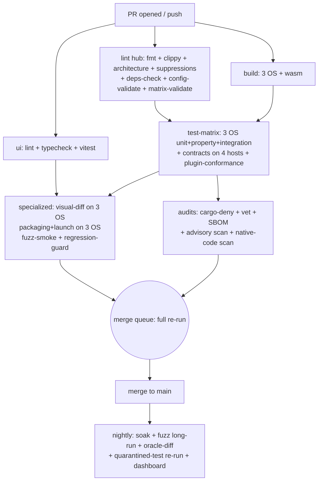

# 10 — Testing, CI & Quality Gates

| | |
|---|---|
| **Implements** | MASTER-PROMPT §13 (testing & CI — primary), §12 (fuzz, untrusted input), §8 (engine invariants under test), §17 (statuses, cycle reporting), §15 (evidence, no self-verification) |
| **Traces to** | doc 01 §5 (boundary CI), doc 02 §2.4 (oracle contract), §4.3/§4.6 (status model, R1–R10), doc 03 §8 (testkit, property tests, scenario table), doc 04 §6 + §8.5 (per-format records, fuzz registry), doc 05 §7 (contract conformance suite) |
| **Consumed by** | doc 13 (wave program — every agent's "commands to run"), doc 15 (git workflow — required checks), all implementation agents |
| **Status** | Planning document. **No command listed here has been executed.** All runtimes are estimates marked `[PROPOSAL]`; every claim of the form "X passes" is a *specification of what must pass*, never a report that it did |

## 0. Scope, sources, cross-document contract

This document is the single specification for how Lumen is tested, how CI gates
merges, and how quality evidence is produced, labeled and consumed. MP §13 is
the normative source; where this document restates MP §13 it does so verbatim
in §2.1 and adds machinery around it. Everything not traceable to the
MASTER-PROMPT or an existing doc is marked `[PROPOSAL]` and awaits Lead
decision (AGENTS.md §3.4/§3.6).

Cross-document status at time of writing (2026-10 planning wave): docs 01–05
exist and are cited by section. Docs 06 (plugins), 07 (config system), 08
(UI/Figma fidelity) and 09 (WASM target) are being written by parallel agents
and were **absent**; their expected contributions are referenced as
*(doc 07 §9 — pending)* etc. and must be reconciled when those docs land:

- **doc 07 §9 (config CI)** — this document's schema-validation and
  config-propagation gates (§4.6 G1/G2) defer tool detail to it.
- **doc 08** — owns screenshot-diff tolerance, viewport/DPI matrix and the
  token proof; this document only specifies the CI job shape (§6.7, §4.6 G7).
- **doc 09** — owns the wasm threading/COOP-COEP plan; the wasm test tier
  here (§4.6 G13) defers execution-environment decisions to it.

Three standing rules govern everything below (MP §13, §15, §17; AGENTS §3.4):

- **R-H1 (honesty).** Report exact commands and actual results. Never claim a
  command ran if it did not. Fabricated evidence is grounds for rejection of
  an assignment (AGENTS §1).
- **R-H2 (no self-verification).** Agents never mark their own work
  `verified`. The parity tool decides from automated evidence (MP §15;
  §7 below).
- **R-H3 (no test weakening).** Never weaken or delete a test to pass it.
  Every defect gets a regression test (MP §13; §8 below).

## 1. Testing principles

1. **Evidence over assertion.** A behavior "works" only when a named,
   re-runnable artifact says so (junit XML, event transcript, diff report).
   Prose claims in PR descriptions are not evidence.
2. **Deterministic by construction.** Tests run on `VirtualClock` and scripted
   sources (doc 03 §8) so failures reproduce. Real-time behavior is tested in
   dedicated soak/timing tiers where non-determinism is budgeted, not in unit
   tests.
3. **Mock and real evidence are separated by labels, never mixed** (MP §13;
   §7 below). A green run on CI virtual devices proves engine logic, not
   platform playback.
4. **Merge-blocking means three operating systems** (MP §13): Windows, Linux,
   macOS. Web/wasm is a fourth gate column (MP §10) enforced in its own job.
5. **Every parser is fuzzed** (MP §12, §6; doc 04 §8.5): a parser crate may
   not reach `implemented` status until its fuzz target exists, has a seed
   corpus, and runs clean.
6. **The contract is the test surface.** All hosts are tested through one
   data-driven conformance suite (doc 05 §7) so the UI cannot drift from the
   engine.
7. **Budgets are explicit.** Test-time, memory-growth and runner-minute
   budgets are numbers in this document, so regressions against them are
   detectable (§10).

## 2. The local gate (exact)

### 2.1 The verbatim command set

MP §13 defines the local gate. The authoritative command list, exactly as the
MASTER-PROMPT states it, extended only with the concrete UI/shell invocations
MP §13 names abstractly (`[PROPOSAL]` marks our concrete choice of tool):

| # | Command (verbatim) | Catches | Expected runtime `[PROPOSAL]` |
|---|---|---|---|
| 1 | `cargo fmt --all -- --check` | formatting drift; avoids review noise, keeps diffs minimal | 5–15 s |
| 2 | `cargo check --workspace --all-targets --all-features` | type errors in every target incl. tests/benches/examples; feature-combination breakage | 2–6 min cold, 20–60 s warm |
| 3 | `cargo clippy --workspace --all-targets --all-features -- -D warnings` | the lint policy of §3 (correctness and style classes), any warning fails | 4–10 min cold, 1–3 min warm |
| 4 | `cargo test --workspace --all-features` | all unit + property + integration tests of §6 | 5–20 min |
| 5 | `cargo tree --workspace` | full dependency graph output; consumed by the assertions of §2.3 (unreviewed new deps, native-code suspects) | 5–15 s |
| 6 | `pnpm --dir ui lint` `[PROPOSAL: pnpm]` | ESLint policy §3.4 (boundary imports, i18n literals, hooks) | 20–60 s |
| 7 | `pnpm --dir ui typecheck` (→ `tsc --noEmit`) | TS type errors under strict flags §3.4 | 30–90 s |
| 8 | `pnpm --dir ui test` `[PROPOSAL: vitest]` | UI unit/component tests (doc 05 §7.3 mock-UI harness lives here) | 1–3 min |
| 9 | `cargo tauri build --debug --no-bundle` `[PROPOSAL: exact flags]` (run in `apps/desktop`) | the desktop shell compiles and links on this host; full bundle is CI's packaging job (§4.6 G9), not the local gate | 5–15 min cold |
| 10 | `wasm-pack build crates/<engine-wasm-binding> --target web --dev` `[PROPOSAL: crate name + flags; binding layout per doc 05 §5.2 / doc 09]` | the wasm32 target still compiles: no accidental native-only dep, no OS-API leak into the engine core | 3–8 min cold |

Total expected: **~20–60 min cold, ~10–20 min warm** `[PROPOSAL — to be
replaced by measured medians once Phase 1 exists; see the honesty note]`.

The honesty rule (R-H1) applies to this table: these are *estimates written
during planning, before any code exists*. When the workspace is real, this
table's runtime column is replaced by measured medians from `gate-report.json`
(§2.4); the replacement PR cites the runs. Nobody may edit the runtime column
by hand after that point — it is tool-generated.

### 2.2 One entry point: `cargo xtask gate` `[PROPOSAL]`

MP §4 already reserves `tools/xtask`; doc 01 §5 puts `check-architecture`
there. We extend it rather than adding a `just`/`make` dependency (one less
tool, cross-platform by construction, shares `cargo metadata` code with
`check-architecture`):

```
cargo xtask gate            # full local gate, commands 1–10 in order, fail-fast
cargo xtask gate --fast     # 1–4 + 6–8 only (pre-push smoke; still fail-fast)
cargo xtask gate --no-ui    # engine-only environments (CI containers reuse this)
cargo xtask gate --json     # writes gate-report.json next to the summary
```

Behavior `[PROPOSAL]`:

- Runs the commands of §2.1 **verbatim** — the xtask shells out to cargo /
  pnpm rather than reimplementing checks, so "what CI runs" and "what the
  gate runs" are literally the same command strings (see §10.4, gate/CI
  parity check).
- Fail-fast by default; `--keep-going` collects all failures for faster
  context on a broken branch.
- Captures per-command `exit code`, wall time, and (for tests) junit-style
  counts into `gate-report.json` (schema in §7.2).
- Prints the exact copy-pasteable report block of §2.4 for the agent's final
  report.

A `justfile` shim (`just gate` → `cargo xtask gate`) is optional
`[PROPOSAL]` for discoverability; it adds no logic.

### 2.3 Assertions over `cargo tree --workspace`

MP §13 lists `cargo tree --workspace` in the local gate; doc 01 §5.2 notes
the tree output is recorded per PR "so new external deps are reviewable".
Concretely, the gate wraps the tree command in `[PROPOSAL:
cargo xtask deps-check]`:

1. Run `cargo tree --workspace` (and, for the auditors, `--edges normal,build,dev`).
2. **Snapshot diff.** Compare against `tools/deps-snapshot.txt`. Any
   added/removed crate in the graph fails the check; regenerating the
   snapshot requires a PR diff a Lead can review — this is the dependency
   approval flow of AGENTS §3.2 made mechanical.
3. **Native-code suspects.** Flag any crate whose packaged name or known
   build script appears in the native-code suspect list
   (cc, nasm, pkg-config, cmake, bindgen dependents) for routing into
   `tools/dependency-audit` (§4.6 G3). The tree alone cannot prove purity;
   it selects targets for the real audit (doc 04 §1.2).
4. **License triage.** Flag licenses outside the allowlist for
   `cargo-deny` confirmation (G3).

### 2.4 The honesty rule, mechanically

AGENTS §3.9 requires the final report to contain "tests run with actual
results"; MP §13 says "Report exact commands and actual results. Never claim a
command ran if it did not." The gate makes this checkable:

- `cargo xtask gate` ends by printing a fenced report block:

```
=== LUMEN GATE REPORT ===
commit:   <sha> (dirty: yes/no)
started:  2026-01-01T00:00:00Z   host: <os> <arch>, toolchain <rustc -V>
1 fmt .................. PASS  12s
2 check ................ PASS  3m41s
3 clippy ............... FAIL  5m02s   crates/demux/src/lib.rs:88:9
4 test ................. NOT RUN (fail-fast)
...
result: FAILURE (1 of 10 failed)
full log: gate-report.json
```

- Agents paste this block verbatim into worklog entries and final reports
  (AGENTS §4). Hand-typed summaries that disagree with a reproducible run are
  treated as fabrication (R-H1).
- CI runs the identical command set (§10.4), so a claimed local PASS that
  fails CI is visible within minutes; the inverse (CI green, agent claims
  more than CI covers) is bounded by the required-checks list (§4.4).
- Partial runs are reported as partial: `NOT RUN (fail-fast)` is a legitimate
  line; "tests: 412 passed" without the block is not.

### 2.5 Local environment prerequisites

`rust-toolchain.toml` pins the toolchain (Lead-owned); Node/pnpm versions are
pinned in `ui/package.json` `engines` + `packageManager` `[PROPOSAL]`; the
VLC oracle (§6.6) is **optional locally** — only agents doing differential
work install the pinned binary per doc 02 §2, and never link against it.

## 3. Lint policy

### 3.1 The workspace lint block (exact)

Root `Cargo.toml`, verbatim implementation of MP §13's lint list:

```toml
[workspace.lints.rust]
unsafe_code = "deny"
unused_must_use = "deny"
unused_imports = "deny"
unused_variables = "deny"

[workspace.lints.clippy]
unwrap_used = "deny"
expect_used = "deny"
panic = "deny"
todo = "deny"
unimplemented = "deny"
dbg_macro = "deny"
await_holding_lock = "deny"
```

What each class catches, and the sanctioned alternative:

| Lint | Catches | Sanctioned alternative |
|---|---|---|
| `unsafe_code` | any `unsafe` outside approved platform adapters (MP §9) | platform adapters cite their ADR in-module (doc 01 §5.2 step 7) |
| `unused_must_use` | silently dropped `Result`/must-use values | explicit match or `let _ =` with comment |
| `unused_imports` / `unused_variables` | dead weight, masking refactor errors | delete them |
| `unwrap_used` / `expect_used` | panic-capable calls in any configuration | typed error propagation; `testkit::t!` in tests (§3.3) |
| `panic` / `todo` / `unimplemented` | unreachable-by-design lying, unfinished paths | typed errors + explicit `Unsupported` variants |
| `dbg_macro` | debug leftovers | log via the stage-tagged error taxonomy |
| `await_holding_lock` | async foot-guns at the sync/async boundary (doc 01 §4.2) | scope locks before `.await` |

### 3.2 Inheritance — every crate, no exceptions

Every crate manifest carries exactly:

```toml
[lints]
workspace = true
```

`[PROPOSAL]` enforcement: `cargo xtask check-architecture` (doc 01 §5) step 0
verifies via `cargo metadata` that every workspace member sets
`lints.workspace = true`, and that no crate overrides a workspace lint to a
lower level. A new crate without the block fails CI.

### 3.3 The no-suppression rule

MP §13: "Never suppress warnings to hide defects." Operational form
`[PROPOSAL]`:

- Any `#[allow(...)]`, `#[expect(...)]`, `#![allow(...)]`, `#[cfg_attr(...,
  allow(...))]`, or `-A`/`--cap-lints` flag outside the registry below fails
  `cargo xtask check-lint-suppressions`, which is part of the `lint` CI job.
- The registry is `tools/xtask/src/lints/suppressions.toml`; each entry
  records: file, lint, reason, approving Lead decision (issue/ADR link), and
  expiry review date. Adding an entry is a Lead-approved PR — an agent may
  propose, never self-approve (mirrors AGENTS §3.2 dependency approval).
- Tests still cannot `unwrap`: the sanctioned test failure path is the
  **single** registered helper `testkit::t!` (one registered `panic` inside
  `crates/testkit`, justification: "the one sanctioned panic point that turns
  a test's `Err` into a failure with full error-chain context"). Everything
  else propagates or asserts.
- Registry hygiene: expired entries fail the check until re-approved or
  removed; the count of active suppressions is a dashboard metric (§9.3)
  with a monotone-decrease expectation `[PROPOSAL]`.

### 3.4 UI-side equivalents

`ui/` mirrors the same philosophy with ESLint flat config + TypeScript
`[PROPOSAL: exact rule wiring]`:

```jsonc
// ui/eslint.config.js (excerpt — full policy co-owned with doc 08)
export default [
  {
    rules: {
      // Boundary: the UI never goes around the command layer (doc 05 §7.4)
      "no-restricted-imports": ["error", {
        patterns: [{ group: ["@tauri-apps/api/*", "!@tauri-apps/api/event"],
                     message: "Use @lumen/client — doc 05 §7.4" }] }],
      // No literal user-visible text where i18n applies (MP §5)
      "@lumen/i18n-no-literals": "error",
      // No direct invoke/listen outside the client (doc 05 §7.4.2)
      "no-restricted-properties": ["error",
        { object: "ipc", property: "invoke", message: "Use @lumen/client" }],
      "no-floating-promises": "error",
      "react-hooks/rules-of-hooks": "error"
    }
  }
]
```

- `@lumen/i18n-no-literals` is a small local ESLint plugin `[PROPOSAL]`:
  JSX text and known copy-bearing props (`label`, `title`, `placeholder`,
  `aria-label`, `alt`) must be i18n keys / `<T k="..."/>` usage, with an
  explicit technical-identifier allowlist (numbers, file extensions, debug
  strings behind a dev flag). This is MP §5's "No literal UI text in Rust or
  TSX" made a merge-blocking check.
- `tsc --noEmit` with `strict`, `noUncheckedIndexedAccess`,
  `exactOptionalPropertyTypes` `[PROPOSAL: the last two may be phased in to
  keep Phase 2 landable]`.
- `pnpm --dir ui test` runs vitest `[PROPOSAL]`; UI screenshot testing is
  doc 08 territory and appears in CI only as job G7 (§4.6).

## 4. CI pipeline

### 4.1 Platform and runner topology `[PROPOSAL: GitHub Actions]`

MP §13: merge-blocking on Windows, Linux, macOS. The pipeline targets GitHub
Actions (workflows in `.github/workflows/`, per MP §4 layout) with this
matrix:

| Runner label | OS/arch | Roles |
|---|---|---|
| `ubuntu-24.04` | Linux x86_64 | lint hub, test-matrix member, wasm tier, audits, packaging (deb/rpm/AppImage), fuzz-smoke, nightly soak |
| `windows-2025` `[PROPOSAL label]` | Windows x86_64 | build/test/packaging (MSI/NSIS), launch test |
| `macos-15` `[PROPOSAL label]` | macOS arm64 (Apple Silicon) | build/test/packaging (dmg), launch test; audio/video device realism |
| `ubuntu-24.04` (containers) | Linux | oracle-diff sandbox (§6.6), plugin-conformance, distro builds |

Self-hosted reference hardware for *real-hardware evidence* (§7) is a later
Phase 3+ addition `[PROPOSAL]`; until it exists, everything CI produces is
labeled mock/virtual and the matrix reflects that honestly.

### 4.2 Job graph



Ordering rule: cheap, high-signal jobs first (`lint` fails in minutes and
cancels downstream via `fail-fast` at the *workflow* level, while the
test-matrix itself runs `fail-fast: false` so one OS failure still reports
the other two `[PROPOSAL]`).

### 4.3 Tiers

| Tier | Trigger | Contents | Wall-clock budget `[PROPOSAL]` |
|---|---|---|---|
| **fast-PR** | every push to a PR branch | `lint` hub, `ui`, build (linux+wasm only), unit+property (linux) | ≤ 12 min |
| **full** (required) | PR marked ready + merge queue | entire graph of §4.2 on all 3 OS + wasm | ≤ 60 min |
| **nightly** | cron on `main` | soak (§6.5), fuzz long-run (§6.8), oracle-diff (§6.6), quarantined-test re-run (§8.3), dashboard regen (§9) | ≤ 5 h |

Fast-PR exists to give authors signal, **not** to gate: only the `full` tier's
checks are required (MP §13's three-OS rule cannot be satisfied by a
linux-only tier).

### 4.4 Required checks and merge queue policy

Branch protection on `main` `[PROPOSAL: exact GH settings]`:

- **Required status checks** (all must pass on the merge-group head before a
  merge lands): `lint`, `ui`, `build (linux)`, `build (windows)`,
  `build (macos)`, `build (wasm)`, `test (linux)`, `test (windows)`,
  `test (macos)`, `contracts`, `plugin-conformance`, `audits`,
  `config-validate`, `matrix-validate`, `visual (linux)`, `visual (windows)`,
  `visual (macos)`, `packaging+launch (linux/windows/macos)`, `fuzz-smoke`,
  `regression-guard`.
- **Merge queue**: GitHub merge queue in "all checks" mode, so a queued PR's
  merge-group head re-runs the full tier against the evolving `main`. No
  batched-skipping — a failed queued batch kicks the offender out and
  re-queues the rest `[PROPOSAL]`.
- Linear history, no direct pushes to `main`, Lead-only merges (AGENTS §3.8
  extends naturally to §15's Lead-merge rule).

### 4.5 Artifacts and evidence store

- Every job uploads artifacts named `evidence-<job>-<os>-<run_id>` containing:
  junit XML (tests), `gate-report.json`-style command logs (§7.2), job-specific
  reports (deny check output, architecture-report.json, screenshot diffs,
  fuzz stats).
- Retention: 90 days for run-of-the-mill runs; phase-gate and release runs are
  pinned and referenced from `docs/evidence/INDEX.md` (generated file — manual
  edits rejected) `[PROPOSAL]`.
- A tiny `evidence-summary` job (or `workflow_run` hook) appends each merged
  run's ledger entries to the evidence index consumed by `tools/parity-report`
  (§7.3).

### 4.6 Specialized gates — the complete list

MP §13 names the CI gates; each below states **runner/what runs it**, **what
fails it**, and **where evidence is stored**. G-numbers are stable IDs used by
dashboards and doc 13 assignments.

**G1 — schema validation.** Runs: `lint` job, linux.
`cargo xtask config-validator` validates `product.toml` against
`product.schema.json`; settings schema self-consistency (type/range/restart/
UI-placement fields present, no option defined twice — MP §5); keymap/layout
files against their schemas; locale files for missing/duplicate keys and
placeholder mismatches (MP §5) *(full policy owned by doc 07 §9 — pending)*.
Fails on: any schema violation, duplicated option, missing translation key.
Evidence: `config-validator-report.json`.

**G2 — config propagation test (rebrand acceptance).** Runs: `test (linux)`
+ a dedicated packaging-adjacent step on all OS. The MP §5 acceptance test:
copy the tree, rewrite `product.toml` (name, short name, accent, publisher,
window title template), rebuild the fast targets, assert the new identity
propagates to window title, installer metadata, About page, `--help` CLI
identity, logs, docs header. Fails on: any stale identity value (MP §5
"duplicated identity values" check). Evidence: `rebrand-report.json` with
before/after greps.

**G3 — native-code + license audit.** Runs: `audits` job, linux.
`cargo-deny` (license allowlist per doc 11's policy, sources, bans,
unmaintained), `cargo-vet` for provenance, SBOM generation
(`cargo auditable` + CycloneDX `[PROPOSAL]`), plus the repo's own
native-code scan: no `.c/.cpp/.m/.S` sources, no build scripts invoking C
compilers outside the ADR allowlist (doc 04 §1.2 method, applied repo-wide).
Fails on: license out of allowlist, unknown/unvetted source, any undeclared
native build step. Evidence: `deny-check.json`, `vet-report.txt`, `sbom.json`,
`native-scan.txt`.

**G4 — vulnerability checks.** Runs: `audits` job. `cargo-deny advisories`
(RustSec) + `pnpm audit --prod`. Fails on: any advisory reachable from a
runtime dependency (dev-dependency advisories open an auto-filed issue and
warn `[PROPOSAL]`). Evidence: `advisory-report.json` + issue link.

**G5 — architecture boundaries.** Runs: `lint` job, all logic per doc 01 §5:
`cargo xtask check-architecture` (layer/allowed-deps/category/cycle/global-
state/unsafe scans + lint-inheritance check §3.2). Fails on: any ARCH-n
violation. Evidence: `architecture-report.json` (per doc 01 §5.2 step 8).

**G6 — feature-matrix validation.** Runs: `lint` job.
`tools/feature-audit` enforces doc 02 §4.6 rules R1–R10: id/status/priority
validity, evidence resolution for `verified` rows (with mock labeling), R7
config cross-check (feature exposure only references implemented matrix ids),
R8 inventory completeness, R9 parse, R10 anti-hallucination. Fails on: any
rule violation or a `not_started → verified` jump (doc 02 §4.3). Evidence:
`feature-audit-report.json` + diff of the matrix file.

**G7 — Figma screenshot diffs.** Runs: `visual` jobs on all 3 OS. Playwright
`[PROPOSAL]` drives the real UI (Tauri webview + the web build) through the
state set defined by doc 08 (viewports × DPI × theme × component states),
diffs against Figma exports with doc 08's tolerance. Fails on: diff beyond
tolerance for a Figma-pinned state. Evidence: per-shot PNG + diff images +
`visual-report.json`. *(Tolerance, viewport list and the "byte-identical is
not claimed" statement live in doc 08 — pending.)*

**G8 — plugin conformance.** Runs: dedicated job, linux. The kit mandated by
MP §6: manifest schema validity for every plugin (builtin + example WASM
extensions), registry enable/disable/reorder via config, capability/priority
selection, API-version gating, and the isolation suite — a panicking or
over-budget WASM plugin must not take down playback (error surfaced,
playback continues), resource limits enforced (memory/CPU). Fails on: any
manifest error, any isolation failure. Evidence: `plugin-conformance.json`.
Every *parser* plugin additionally shows a green fuzz-smoke entry for its
registered target (G10).

**G9 — packaging + launch tests.** Runs: per-OS `packaging+launch` jobs.
Build the real bundles (MSI/NSIS, dmg+app, deb/rpm/AppImage
`[PROPOSAL: bundle set per doc 15]`), install on a clean runner, launch the
installed binary, open + play the smoke fixture through the command layer,
verify first-frame event, exit cleanly, assert exit code 0 and no leftover
processes. Fails on: install failure, launch failure, no playback, crash,
leftover processes. Evidence: install log, launch transcript
(`packaging-launch-report.json`).

**G10 — fuzzing + property tests (per-PR tier).** Runs: `fuzz-smoke` job.
Every registered fuzz target builds and runs a short coverage-guided burst
(seed corpus + 60–120 s/target `[PROPOSAL]`) in release mode; property tests
run inside the normal test-matrix (they are regular `proptest` tests —
§6.3). Fails on: any crash/timeout/asan finding or property failure.
Evidence: `fuzz-smoke.json` (target, corpus size, execs, status). Long-run
fuzzing is nightly (§6.8).

**G11–G13 — the remaining standing jobs.** *G11 contracts* (doc 05 §7): the
data-driven conformance suite across all four hosts — TauriMockHost,
WasmNodeHost, CliHost, ControlHost — including stale-generation races and
truth-rule assertions; runs in `test` jobs (native hosts on 3 OS; wasm host
in the wasm job); fails on any scenario mismatch; evidence junit + event
transcripts per scenario. *G12 wasm build+test*: `wasm-pack build`, engine
wasm-bindgen tests under Node and headless Chrome (Chrome/Firefox/Safari
browser matrix is doc 09/10's MP §10 duty — here we run Chromium in CI and
label it as such), COOP/COEP headers asserted for the threaded profile
`[PROPOSAL pending doc 09]`. *G13 regression-guard*: the §8.2 test-count/
deletion heuristic below.

### 4.7 Workflow sketch `[PROPOSAL]`

```yaml
# .github/workflows/ci.yml (excerpt — shape, not final)
jobs:
  lint:
    runs-on: ubuntu-24.04
    steps: [checkout, rust-cache, "cargo fmt --all -- --check",
            "cargo xtask check-architecture", "cargo xtask check-lint-suppressions",
            "cargo xtask deps-check", "cargo xtask config-validator",
            "cargo xtask feature-audit", upload evidence]
  test:
    strategy:
      fail-fast: false
      matrix: { os: [ubuntu-24.04, windows-2025, macos-15] }
    steps: ["cargo clippy --workspace --all-targets --all-features -- -D warnings",
            "cargo nextest run --workspace --all-features --profile ci",   # junit [PROPOSAL]
            "cargo xtask contracts", upload evidence]
```

## 5. Test corpus (`tests/fixtures`)

### 5.1 Layout and the licensing ledger

```
tests/fixtures/
  CORPUS.md            # the ledger: every acquired file, one row each
  acquired/            # legally-distributable real files (never generated)
    audio/ video/ containers/ subs/ playlists/ images/
  generated/           # outputs of testkit generators (CC0, reproducible)
  expectations/        # per-fixture TOML (§5.4)
  scripts/             # the generators themselves (Rust, in testkit)
```

`CORPUS.md` is the licensing ledger mandated by doc 04 §8.5: for every
non-generated file — name, sha256, size, source URL, license (verbatim
statement or link), license classification (public-domain / CC0 / CC-BY /
other-allowlist), the date acquired, and the matrix rows / per-format records
that consume it. **A fixture without a ledger row fails G6** (feature-audit
extends its file check to the corpus) `[PROPOSAL]`. Allowed licenses for
fixtures: public-domain dedications, CC0, CC-BY (attribution carried in the
ledger), and project-licensed test files `[PROPOSAL — final allowlist is doc
11's call]`. No fixture may be extracted from VLC or any media player
distribution (clean-room, MP §2).

### 5.2 Acquired fixture inventory plan

Minimal-but-real files, one or two per supported format, grown with the
per-format roadmap (doc 04). Target inventory for the P0/P1 set:

| Class | Files | Notes |
|---|---|---|
| per-format minimal | 1 smallest-valid file per format row in doc 04 §2–§5 (wav, flac, ogg(+flac), mp3, mp4(+mov variant), mkv/webm, ts, adts, avi, aiff, ps) | < 2 MB each preferred |
| multi-track | mkv with 2 audio + 2 subtitle tracks; mp4 with audio+video+chapter track | track-switch scenario |
| chapters | mkv + mp4 with chapter atoms | timed-event model (doc 03 §4.12) |
| subtitles | srt (incl. overlap + malformed line), ass (plain + styled), vtt (incl. cue settings) | per doc 04 sub table |
| cover art / metadata | flac with PICTURE block, mp3 with ID3v2 art, mkv attachment | metadata events |
| long / short | one ≥ 30 min file (or generated §5.3), one 0.1 s clip | soak + short-media edges |
| network | m3u/pls/xspf playlists (relative+absolute URIs), HLS media playlist (local file server) | interrupted-network via fault scripts, not flaky nets |

### 5.3 Generated fixtures (the default, not the fallback)

MP §13 requires "generated malformed, truncated, multi-track and
discontinuous-timestamp cases"; doc 03 §7 chose AVI+MJPEG+PCM as the first
vertical partly because synthetic generation is trivial. The generators live
in testkit (`tests/fixtures/scripts/` → `cargo xtask gen-fixtures`
`[PROPOSAL]`) and are deterministic (fixed seeds; byte-identical output):

- **Synthetic A/V encoders**: sine-wave PCM at sample rates/bit depths;
  tone bursts; MJPEG from procedurally drawn colorbars/counters (frame
  content encodes the frame index so seek accuracy is assertable); AVI/MKV/
  WAV/ogg writers emitting them. Duration, fps, channel counts are
  parameters — the 4 h soak file and the 0.1 s edge file are generated, not
  downloaded.
- **Malformed generators**: bit-flip and header-field corruption with
  recorded offsets; invalid magic; absurd-but-parseable size fields (bounded
  memory checks, MP §12); truncated-at-offset writers (every K-th byte cut);
  container files referencing out-of-range track ids.
- **Discontinuous timestamps**: writers that emit PTS jumps, PTS < DTS,
  negative deltas, rollovers near u32/i64 edges — the corpus for doc 01 §3.2
  / doc 03 §3 error variants.
- All generated files are CC0 (we authored them) and excluded from the
  license-ledger size concerns; the generator run is itself verified by
  re-generating in CI and diffing hashes `[PROPOSAL]`.

### 5.4 Recorded expectations

Every fixture (acquired or generated) has `tests/fixtures/expectations/
<fixture>.toml` `[PROPOSAL: format]`:

```toml
schema = "expectation/1"
fixture = "generated/colorbars-30s-1080p.mkv"
sha256 = "…64 hex…"
size_bytes = 58_112_004

[tracks]
count = 2
video = [{ id = 0, codec = "mjpeg", width = 1920, height = 1080, fps = { num = 30, den = 1 } }]
audio = [{ id = 1, codec = "pcm_s16le", rate = 48_000, channels = 2 }]

duration_us = 30_000_000
[seek]
targets_us = [0, 1_000_000, 15_000_000, 29_999_000]
tolerance_us = 33_333
[first_frame]
hash_y = "…"   # 8x8-block mean descriptor (per doc 03 §8 FrameRecorder)
stamp_us = 0
[audio_probe]
first_samples_md5 = "…"  # first 4800 samples after pinned conversion to f32
```

Expectations are recorded from **Lumen's own first compliant run** (or, for
differential rows, cross-checked against the VLC oracle — §6.6) and then
frozen: a change to an expectation file requires the same regression
paperwork as deleting a test (§8.2), because a silently re-blessed
expectation is a weakened test.

### 5.5 Corpus size budget `[PROPOSAL]`

`acquired/` ≤ 150 MB total; no single file > 20 MB except the one long-media
reference (≤ 60 MB) — anything larger is generated locally or fetched from a
pinned URL with hash verification by the CI job (not committed). Git LFS is
avoided if the budget holds `[PROPOSAL — decision with doc 15]`.

### 5.6 Mapping to per-format records and the matrix

Doc 04 §6's record template has a `## Corpus` section: each per-format record
lists the fixtures that exercise it (ledger names), and each expectation file
names the matrix row ids it provides evidence for. `tools/feature-audit` (G6)
checks the bidirectional mapping: a format row claiming `implemented` or
better must cite at least one green fixture + expectation, and a fixture that
nothing consumes is flagged as dead weight `[PROPOSAL]`.

## 6. Test taxonomy and ownership

### 6.1 Levels

| Level | Lives in | Owner | Cadence | Merge-blocking |
|---|---|---|---|---|
| Unit | `crates/<c>/src` + `tests/` per crate | crate owner (doc 01 §6.3 map) | every run | yes |
| Property | per crate `tests/prop.rs` + testkit generators | crate owner | every run | yes |
| Integration (scenarios) | `tests/integration/` via `SessionHarness` | engine owner + scenario owner | full tier | yes |
| Contract conformance | `tests/contract/scenarios/*.toml` (doc 05 §7) | command-layer owner | full tier | yes |
| Soak / stress | `tests/stress/`, nightly | engine owner | nightly | gates the next release/phase gate, not each PR |
| Differential (oracle) | `tests/compatibility/` driving the pinned VLC | codec/demux owners | weekly + label `[PROPOSAL]` | when opted in |
| Visual / screenshot | `tests/visual/` (spec in doc 08) | UI owner | full tier | yes |
| Fuzz | `fuzz/` | parser owners | smoke per PR; long-run nightly | smoke yes |

### 6.2 Unit tests

Ordinary per-crate `#[test]`s; the merge rule from doc 01 §6.1 ("tests" is one
of the seven crate gates): a crate PR without tests for changed behavior is
incomplete by definition. Unit tests use `testkit::t!` (§3.3) and the virtual
devices; no sleeps, no wall-clock dependence — `VirtualClock` only (doc 03
§8).

### 6.3 Property tests

`proptest` `[PROPOSAL: framework; doc 03 §8 says candidate framework per doc
04]`, seed recorded in CI output for replay. The standing properties:

1. **Time-base conversion** (MP §8): rational rescale is exact or reports
   `Overflow`; missing timestamps stay `Missing`; discontinuities flagged, never
   silently interpolated (doc 01 §3.2).
2. **Queue bounds**: bounded queues never exceed capacity under adversarial
   interleavings; backpressure observed; generation stamps drop stale entries
   (doc 03 §4.4).
3. **Generation races**: random command storms (seek/stop/switch interleavings)
   never produce stale output — the doc 03 §5 guarantee as a machine-checked
   property.
4. **Config merge**: layered precedence (product → profile → admin → user →
   flags → session, MP §5) holds for random layer contents; invalid critical
   config fails loudly, never silently defaults.
5. **State-machine model checking**: random command sequences vs the doc 05
   §3.3 transition table — illegal transitions and stuck states are failures.
6. **Playlist order semantics**: deterministic order under shuffle-seed
   properties (doc 03 §4.13).

### 6.4 Integration scenarios — the complete MP §13 list

Every scenario is a named test with a stable ID; evidence artifact = junit
case + `transcripts/<scenario>.json` (full event log from `SessionHarness`).
Drivers per doc 03 §8.

| Scenario | Driver (doc 03 §8) | Pass criteria | Evidence |
|---|---|---|---|
| `open` | `ScriptSource` valid + variants | tracks/duration correct or typed error with stage+code; never success-with-garbage | junit + probe transcript |
| `play` | `SessionHarness` + sinks | first-frame event + samples flow; A/V stamps within tolerance | event transcript |
| `pause` / resume | virtual clock freeze | zero samples while paused; resume at same media time | transcript + sink counters |
| `seek` | §6 flow of doc 03 on 3 targets | `Seeked{actual}` within tolerance; no stale frames after completion | transcript |
| `stop` | stop mid-stream | teardown complete (threads/fd/device released) within deadline | teardown report |
| `repeated seeks` | 100 random targets, no waits | no stale output ever; bounded memory; each completes or typed-fails | memory profile + transcript |
| `A/V sync` | instrumented sinks, full playback | drift within doc 03 §4.10 tolerance at checkpoints | drift report per checkpoint |
| `track switching` | multi-track synthetic container | new track's first frame carries the switch generation; no old-track frames after | transcript |
| `corrupt file` | malformed corpus (§5.3) | typed `Corrupt`; bounded recovery count; no hang/crash | per-fixture results matrix |
| `missing file` | absent path, unreadable path | typed `Inaccessible` with redacted message | transcript |
| `interrupted network` | `ScriptSource` hang/reset/truncate scripts | `Buffering` → resume or typed error; no hang (deadlines fire) | timeline transcript |
| `device loss` | `VanishingSink` | `DeviceLost` event; position preserved or explicit suspension; recovery on return | transcript |
| `long media` | synthetic 4 h stream (soak tier) | `Ended` reached; memory growth within §6.5 budget | soak report |
| `short media` | 0.1 s clip | edge cases per doc 03 §4.6 (Ended vs Buffering race) | transcript |
| `reopen cycles` | 1000× open/play/stop | thread/fd/byte counters return to baseline | leak counters |
| `exit during playback` | drop session mid-decode | teardown within deadline; device closed; exit code clean | teardown report |

The scenario list is closed: adding a scenario is a doc change (this file),
removing one is impossible without Lead sign-off (§8.2).

### 6.5 Soak and stress (nightly)

- **Duration**: 4 h playback of the generated long fixture, looping playlists,
  and a seek-storm variant (random seeks every 1–5 s) `[PROPOSAL]`.
- **Memory-growth assertion**: RSS and queue-resident-bytes sampled every
  60 s; linear-regression slope must stay < 5 MB/h `[PROPOSAL — number to be
  justified by first measured baseline, then frozen]`.
- **Leak detection**: testkit thread/fd counters (doc 03 §8) + nightly
  LeakSanitizer run of parser crates on linux `[PROPOSAL — needs nightly
  toolchain component]`.
- **Stress**: 50 concurrent playlist entries, track-switch storms, subtitle
  floods (100 cues/s), config reload loops.

### 6.6 Differential testing vs VLC 3.0.23 (the oracle)

Clean-room rules from MP §2 and doc 02 §2: the pinned binary runs
**externally**, never vendored, never linked; every invocation asserts the
version pin (drift aborts the run); sandboxed container, no egress.

**Harness** `[PROPOSAL: driver in tests/compatibility/, orchestration in
tools/parity-report, timing in tools/bench-vs-vlc]`. Per fixture, both
players decode; the harness compares:

- **Duration** — exact within ±1 timebase unit.
- **Track inventory** — count, kind, codec id, language (via VLC M1 log
  parse, doc 02 §2.4).
- **Decoded audio** — MD5 of the full decoded PCM stream after both sides
  pin sample format/rate/channels; valid where the path is lossless end to
  end (PCM passthrough, FLAC, ALAC…) `[VERIFY: VLC transcode chain
  determinism — doc 02 M2's open question]`. Where bit-exactness cannot be
  claimed, sample-wise RMS + peak deviation with thresholds (doc 02 M2).
- **Frame hashes at sample points** — every Nth frame's 8×8 block-mean
  descriptor of the Y plane after pinned conversion; exact match for
  lossless codecs (MJPEG, raw video); PSNR/SSIM thresholds for lossy ones.
  Byte-equality of lossy decode is **never** claimed (doc 02 M2).
- **Seek accuracy** — target vs actual position, ±1 frame.

**What cannot be compared deterministically** (documented, not hidden):
lossy-codec decode bytes (different conforming implementations),
subtitle/text rendering (font stacks differ), hardware-decode paths (OS
decoders differ; comparisons pin VLC to software decode `[VERIFY: flag]`),
wall-clock timing (that is the M4 benchmark protocol, not a pass/fail), and
error message text (compare *error class* only).

**Oracle availability in CI** `[PROPOSAL]`: weekly scheduled full-differential
run on the sandboxed linux container over the whole corpus; plus on-demand
per-PR via the `oracle-diff` label (auto-suggested when a PR touches a crate
with a differential baseline — then merge-blocking). Not per-PR by default:
install + sandbox + runtime cost is not justified on every merge. Evidence:
`oracle-diff-report.json` per fixture → feeds per-format records' `##
Results` section (doc 04 §6) and matrix evidence.

### 6.7 Visual / screenshot tests

Owned by doc 08 (pending): tolerance, viewport/DPI/theme matrix, Figma export
procedure. CI shape here: `visual` jobs on all 3 OS run the doc 08 state set
against both the desktop webview and the web build (G7); evidence is per-shot
PNG + diff + report. OS text rasterization differences are why tolerance, not
byte equality, is the rule (MP §7).

### 6.8 Fuzzing

**Target registry** — MP §12 + §6 ("every parser has a registered fuzz
target"), names exactly as doc 04 §8.5. Initial registry (Phase 1–5 growth
order; each target = one `fuzz/<name>.rs`, cargo-fuzz + libFuzzer,
coverage-guided, ASan):

- **Demuxers**: `fuzz_demux_wav`, `_flac`, `_mp4`, `_mkv`, `_ogg`,
  `_mp3stream`, `_adts`, `_ts`, `_ps`, `_avi`, `_aiff`, `_asf`, `_m4v`,
  `_caf`, `_rm`, `_tx3g`.
- **Codecs**: `fuzz_codec_pcm`, `_mp3`, `_aac`, `_flac`, `_alac`, `_vorbis`,
  `_opus`, `_adpcm`, `_truehd`, `_ac3`, `_dts`, `_wma`, `_wavpack`,
  `_speex`, `_mpc`, `_midi`, `_av1`, `_mjpeg`, `_rawvideo`, `_mpeg2`,
  `_theora`, `_vp8`, `_vp9`, `_h264` (parser), `_hevc` (parser).
- **Subtitles**: `fuzz_sub_srt`, `_ass`, `_vtt`, then PGS/DVB/VobSub/TTML as
  they land.
- **Playlists**: `fuzz_playlist_m3u`, `_pls`, `_xspf`.
- **Network framing** `[PROPOSAL initial set]`: `fuzz_net_http_header`,
  `_m3u8` (HLS), `_mpd` (DASH), `_rtsp_message`.
- **Cross-cutting**: `fuzz_probe` (media-probe on arbitrary bytes),
  `fuzz_commands_json` (command-layer boundary validation — MP §3.9/§12).

**Corpus seeding**: each target's seed corpus = the valid fixtures for its
format + the malformed/truncated generator outputs (§5.3) + minimized crash
cases (which also become regression tests, §8.1). Corpora live in
`fuzz/corpora/<target>/` `[PROPOSAL: committed compressed; growth merged by
the nightly job via auto-PR]`.

**Continuous fuzzing** `[PROPOSAL]`: G10 per-PR smoke (build + 60–120
s/target, release mode, per doc 04 §8.5's "runs 10 minutes clean" rule
interpreted as aggregate budget for the smoke tier and 10 min/target for
nightly); nightly 30–60 min/target with corpus growth; OSS-Fuzz submission
once the project is public (Phase 3+) — the OSS-Fuzz-style discipline (no
untriaged crashes, minimized repros committed) applies from day one
regardless.

## 7. Evidence: mock vs real, the ledger, and the parity tool

### 7.1 Labels

MP §13: "Label mock evidence separately from real hardware evidence." Two
axes, recorded on every artifact:

- `environment.kind`: `ci-vm` | `reference-hardware` | `local`.
- `hardware_class`: `mock` (VirtualClock, null/software sinks, CI VMs) |
  `real` (actual audio device, GPU output, physical media on the reference
  machine). DVB/capture evidence is `real`-only and hardware-gated (MP §14).

CI-produced evidence is **always** `mock` until the reference-hardware tier
exists (§4.1). The feature matrix honors this: per doc 02 R4, mock evidence
may support `implemented`/`partial` and engine-logic claims, but
platform-`verified` claims on hardware-dependent behavior require
`hardware_class = real` artifacts on each claimed platform `[PROPOSAL:
exact per-category rule split — which matrix categories accept mock evidence
is a Lead decision recorded in doc 02's schema notes]`.

### 7.2 Evidence ledger format

`gate-report.json` / per-job reports share one envelope `[PROPOSAL: schema
"evidence/1"]`:

```json
{
  "schema": "evidence/1",
  "run_id": "gha-88123-merge-queue",
  "commit": "<sha>",
  "started_at": "2026-01-01T00:00:00Z",
  "environment": {
    "kind": "ci-vm", "os": "linux", "image": "ubuntu-24.04",
    "hardware_class": "mock",
    "devices": ["null-audio", "software-render"]
  },
  "commands": [
    { "cmd": "cargo test --workspace --all-features", "exit": 0,
      "duration_s": 412, "junit": "junit/test-linux.xml" }
  ],
  "labels": ["mock", "virtual-clock"]
}
```

Timestamps, commit SHA and runner env are machine-written; nothing in the
ledger is hand-editable (docs/evidence/INDEX.md is generated, §4.5).

### 7.3 How `tools/parity-report` sets verified status

Per MP §15 and doc 02 §4.3: **agents never mark their own work verified; the
tool decides from evidence.** Flow `[PROPOSAL: details]`:

1. `parity-report collect` reads the evidence index (§4.5) + matrix + records.
2. For each matrix row it checks the verified-criteria of MP §17 (specified,
   complete incl. error paths, tested per claimed platform, documented
   limits, non-regressing) against concrete artifacts: green scenario IDs
   (§6.4), per-platform job results, doc links, no open regression tagged to
   the row.
3. It writes **transition proposals** (`implemented → verified` candidates,
   with the artifact list) to `tools/parity-report/outbox/transitions.json`.
   It never edits the matrix directly.
4. The Lead applies proposals in a reviewable PR; `feature-audit` (G6)
   rejects `not_started → verified` jumps and unbacked transitions (doc 02
   §4.3), so even the Lead cannot shortcut evidence.

## 8. Regression protocol

### 8.1 Every defect gets a regression test

Workflow (AGENTS §3.5 made concrete):

1. Defect filed (issue) with the smallest known repro.
2. `tests/regression/reg-<issue>-<slug>.rs` written **first**, referencing
   the issue and the offending commit; it must fail on the pre-fix code
   (verified in CI history or by temporarily reverting locally — the
   report states which `[PROPOSAL]`).
3. Fix lands with the test in the same PR; CI green.
4. Fuzz-found crashes follow the same path: minimized via `cargo fuzz tmin`,
   committed as both a regression test and a seed corpus entry.

### 8.2 Never weaken or delete a test (enforced)

- **Review checklist**: the Lead's accept/reject pass includes "no test,
  assertion, expectation or tolerance was weakened, deleted, or re-blessed
  without an approved issue" (AGENTS §1, §3.5; MP §13).
- **G13 regression-guard** `[PROPOSAL]`: a CI step compares the test
  inventory (`cargo test --workspace -- --list` + scenario TOML ids +
  expectation-file hashes) between base and PR. A net decrease in tests, a
  deleted scenario id, a new `#[ignore]`, or a changed expectation hash
  fails the job unless the PR body carries `test-change: <issue-or-ADR>`
  referencing Lead approval. This is a heuristic tripwire, not proof —
  but it makes silent weakening noisy.
- Expectation re-blessing (§5.4) follows the same rule: a changed hash is a
  weakened assertion until justified.

### 8.3 Flaky-test policy: quarantine, not deletion

1. A test that fails intermittently (CI retry with `--retry 1` marks it)
   gets an issue with the failure output and last-green SHA.
2. It moves to `tests/quarantine/` (excluded from the default gate) with a
  header comment: issue, deadline (default **14 days** `[PROPOSAL]`), owner.
3. The nightly tier re-runs quarantined tests (§4.3); a pass does not
   silently graduate it — graduation is a PR with the flake root-cause noted.
4. Deadline expiry escalates to the Lead: fix it, or delete with full §8.2
   paperwork. The quarantine count is a dashboard metric; a test may not be
   re-quarantined for the same symptom without Lead sign-off `[PROPOSAL]`.

## 9. Quality dashboards and reporting

### 9.1 The cycle report (MP §17)

After each cycle (wave/phase iteration), `tools/parity-report cycle`
`[PROPOSAL: subcommand]` generates the skeleton with machine-known fields
filled from the evidence index; the author completes the rest; the Lead
reviews. Template — the §17 fields verbatim:

```markdown
## Cycle report — <task-id> <date>
Implemented:      <what was built>
Changed:          <interfaces/config/docs changed>
Verified:         <commands + actual results: gate-report block or CI links>
Compatibility:    <formats × platforms tested, from evidence index>
Dependency compliance: <G3/G4 outcomes, new deps approved>
Known gaps:       <matrix partial/blocked rows touched>
Risks:            <new/changed risk-register entries>
Next action:      <single concrete next step>
```

A cycle counts as done only when failing checks are fixed first (MP §17) —
the report's *Verified* section must not contain red CI links.

### 9.2 Feature-matrix status automation

Status transitions flow only through the §7.3 outbox → Lead PR → G6 path;
the dashboard shows the computed rollups (raw + P0-only parity, per doc 02
§4.3) and the pending transition proposals queue.

### 9.3 Metrics dashboard

Generated nightly into `docs/reports/dashboard.md` `[PROPOSAL]`: test count
trend, pass rate, flake rate (quarantine + retry marks), lint-suppression
count (§3.3), fuzz execs + open crashes, differential pass rate, runner
minutes vs budget (§10.4), coverage delta (llvm-cov, linux-only
`[PROPOSAL]`), soak memory slope.

## 10. CI for the CI (speed, budget, self-checks)

### 10.1 Caching

`Swatinem/rust-cache` keyed on `Cargo.lock` + `rust-toolchain.toml` +
job-name; pnpm store + ui build cache; wasm target/toolchain cache; sccache
for the heaviest dependency chains `[PROPOSAL]`; merge-queue runs use the
`refs/heads/gh-readonly-queue/**` key fallback so they still hit warm
caches. Concurrency groups cancel superseded pushes per PR `[PROPOSAL]`.

### 10.2 Incremental and parallel

`cargo-nextest` `[PROPOSAL]` for junit + process-parallel test runs (with
`--retry 1` and flake reporting, §8.3); workspace test partitioning by crate
group if a single-OS run exceeds 20 min `[PROPOSAL]`; `cargo clippy` reuses
`cargo check` artifacts within a job; UI build shared between the `ui` and
`visual` jobs via artifact hand-off `[PROPOSAL]`.

### 10.3 Tiering

Restating §4.3 as the speed mechanism: authors get ≤ 12-minute signal
(fast-PR), merges pay for the full 3-OS matrix (≤ 60 min, required — this is
the MP §13 obligation and is not negotiable by tuning), expensive evidence
(soak, long fuzz, oracle) is nightly/weekly where it does not gate correctness
of the merge itself.

### 10.4 Runner-minutes budget `[PROPOSAL]`

Assumptions: 200 PR pushes/month, 60 merges/month, 22 nightly runs.
Estimates: fast tier ≈ 40 min/push (linux only) → ~135 h; full tier ≈ 6
runner-hours/merge (incl. 10× macOS multiplier weighting) → ~360 h; nightly ≈
8 h/run → ~175 h; visual + packaging included above. **Total ≈ 670 h/month**
on GH-hosted pricing classes. Alerts at 70%/90% of an agreed ceiling; the
first tuning lever is fast-tier breadth, never required checks. Exact labels
(`windows-2025`, `macos-15`) and a possible self-hosted Linux runner for
soak/fuzz are budget decisions for the Lead with doc 15.

### 10.5 Pipeline self-checks

- `actionlint` + workflow schema validation in the `lint` job `[PROPOSAL]`.
- **Gate/CI parity check**: CI jobs invoke the same command strings as
  §2.1 — enforced either by routing every CI job through
  `cargo xtask ci <job>` `[PROPOSAL: strong form]` or by a canary that
  greps the workflows for drift from the xtask's exported command list
  (weak form). Drift between "what the agent ran" and "what CI runs" is
  exactly the honesty-rule attack surface (§2.4).
- Nightly "canary merge-queue" run on `main` even with no PRs, so breakage
  of the pipeline itself is discovered by us, not by a contributor
  `[PROPOSAL]`.

## 11. Open questions for the Lead

1. CI platform confirmation (GitHub Actions vs alternatives) and whether a
   self-hosted Linux runner joins early for soak/fuzz budget relief (§10.4).
2. macOS matrix breadth: arm64 only, or also x86_64? (MP §1 says "macOS"
   generically; doc 02's pin record covers both.)
3. Differential oracle cadence: weekly vs nightly; opt-in label
   merge-blocking rules (§6.6).
4. Tool picks: pnpm/vitest/nextest/proptest/Playwright (all `[PROPOSAL]`).
5. Which matrix categories may reach `verified` on mock evidence alone
   (§7.1) — the engine-logic vs hardware-behavior split.
6. Corpus storage: LFS vs pinned-URL fetch for the long-media reference
   (§5.5).
7. Whether `--retry 1` in nextest is acceptable given flake-hiding risk, or
   failures must always surface with quarantine following (§8.3).
8. Ownership rota for quarantine expiry triage and fuzz-crash triage (§8).

### Proposal index (Lead triage list)

`cargo xtask gate` + report block (§2.2/§2.4); deps-snapshot assertions
(§2.3); suppression registry (§3.3); GHA matrix + merge queue settings
(§4.1/§4.4); G1–G13 job designs (§4.6); corpus layout/ledger/budget
(§5); expectation format (§5.4); proptest (§6.3); soak numbers (§6.5);
oracle harness + cadence (§6.6); fuzz registry growth + CI budget (§6.8);
evidence schema + parity outbox (§7); regression-guard heuristic + flaky
deadlines (§8); dashboard + cycle subcommand (§9); caching/tiering/minutes
(§10).

---

*This document specifies; it does not report. Every "passes" above means
"must pass" — the first actual results appear in Phase 1's gate reports and
supersede the estimates herein (R-H1).*

